# vDB

vDB is a small **in-memory database** written in C++11 **without the C++ standard library** (no STL, no exceptions,
no RTTI), so the same code runs on a PC and on a microcontroller (ESP32, ATmega2560). It stores **records**, not rows of
a fixed schema: each record is a set of named fields, and two records of the same table may have different fields. You
ask it questions in **standard SQL text** or with a **C++ word chain**
(`db.select("name").from("people").where.field("age").gt(30).run()`). The result of one query can **flow into the
next** with the pipe operator `|>`. Values are **flexible**: everything is kept as text, and each operation decides how
to read it. On top of the library sit two programs: **`sel`**, a SELECT typed on the command line over CSV files, and
**`vdb`**, an interactive SQL shell.

```sh
sel name, age from people.csv where "age > 30" order by age desc
```

- **SQL you already know:** SELECT with JOINs (inner, left, right, full, cross), GROUP BY, HAVING, ORDER BY, LIMIT,
  subqueries, WITH, UNION / INTERSECT / EXCEPT, INSERT, UPDATE, DELETE, CREATE TABLE, DROP TABLE.
- **Pipelines:** `SELECT ... |> WHERE ... |> ORDER BY ... |> LIMIT 5` (BigQuery-style); `_` names the previous result.
- **Flexible values:** `age > 30` compares numbers, `zip = '01234'` compares text, `phone LIKE '%555%'` looks for digits
  as text — in the same WHERE. A math comparison never matches text that is not a number.
- **92 functions and aliases:** text (UTF-8 aware), regular expressions (linear time, no backtracking), math,
  aggregates.
- **CSV in and out:** any delimiter (`;` by default) or a regular expression, quoted multi-line fields, decimal comma,
  output as CSV, TSV, a table, JSON, JSON lines or Markdown.
- **Streaming:** a filter over a large CSV file reads one row at a time; `LIMIT 10` reads 10 rows.
- **Safe:** nothing throws, aborts or prints; running out of memory is an error; user values go in as escaped literals
  or `?` parameters; nesting is bounded; a syntax error changes nothing.
- **Small machines:** memory comes from an allocator you choose — the heap, a static arena or a capped budget.

Version 1.0.0 · MIT license · normative specification: [`spec.md`](spec.md) · repository:
[github.com/solariun/vDB](https://github.com/solariun/vDB)

---

## Contents

1. [Quick start in 60 seconds](#1-quick-start-in-60-seconds)
2. [The idea in pictures](#2-the-idea-in-pictures)
3. [`sel`: a SELECT on the command line](#3-sel-a-select-on-the-command-line)
4. [`vdb`: the interactive shell](#4-vdb-the-interactive-shell)
5. [The C++ library](#5-the-c-library)
6. [Flexible values in depth](#6-flexible-values-in-depth)
7. [SQL reference](#7-sql-reference)
8. [Microcontrollers](#8-microcontrollers)
9. [Safety](#9-safety)
10. [Building and testing](#10-building-and-testing)
11. [Project layout](#11-project-layout)
12. [Limits](#12-limits)
13. [License](#13-license)

---

## 1. Quick start in 60 seconds

**In plain words.** Build with `make`, put `bin/` on your `PATH`, go to the example data and type a SELECT after the
word `sel`. Nothing else is needed: no server, no schema, no dependencies beyond a C++11 compiler.

```sh
git clone https://github.com/solariun/vDB && cd vDB
make                          # the library, sel, vdb and the examples
export PATH="$PWD/bin:$PATH"  # or: make install (to /usr/local/bin)
cd examples/data
```

Who is older than 30?

```sh
sel name, age from people.csv where "age > 30" -o table
```

```
+-------+-----+
| name  | age |
+-------+-----+
| Ana   |  31 |
| Davi  |  45 |
| Fábio |  38 |
+-------+-----+
(3 rows)
```

How many people per city?

```sh
sel city, "count(*) as n" from people.csv group by city order by n desc -o table
```

```
+----------------+---+
| city           | n |
+----------------+---+
| Rio de Janeiro | 2 |
| São Paulo      | 2 |
| Recife         | 1 |
| Porto Alegre   | 1 |
| Belo Horizonte | 1 |
+----------------+---+
(5 rows)
```

Which customer bought what? (two files, one join)

```sh
sel "o.id, c.name, o.product, o.price" from orders.csv o join customers.csv c on "o.customer_id = c.id" -o table
```

```
+-----+------+--------------+--------+
| id  | name | product      | price  |
+-----+------+--------------+--------+
| 100 | Ana  | antenna      | 120.50 |
| 101 | Ana  | coax cable   |  12.00 |
| 102 | Davi | radio        | 899.90 |
| 103 | Eva  | antenna      | 120.50 |
| 104 | Eva  | power supply | 150.00 |
+-----+------+--------------+--------+
(5 rows)
```

Notice the quotes around `"age > 30"` and `"count(*) as n"`: the shell would otherwise eat the `>` and the `*`.
[§3.3](#33-shell-safety-quote-what-the-shell-would-change) explains why, and the simplest rule: **quoting the whole
query always works** — `sel "name, age from people.csv where age > 30"`.

The data used in this README is in [`examples/data/`](examples/data). `people.csv` is:

```
name;age;city;phone;email
Ana;31;Rio de Janeiro;+55 21 5550-1234;ana@example.org
Bruno;N/A;São Paulo;+55 11 5550-9876;
Carla;017;Recife;;carla@example.org
Davi;45;Rio de Janeiro;+55 21 5554-0000;davi@example.org
Eva;22;Porto Alegre;+55 51 5550-5550;eva@example.org
Fábio;38;São Paulo;+55 11 5559-1111;fabio@example.org
"Gil ""Junior""";29;"Belo Horizonte";+55 31 5550-2222;gil@example.org
```

Bruno's age is `N/A` and Carla's is `017` on purpose: they show how flexible values behave (§6).

---

## 2. The idea in pictures

### 2.1 Layers

**In plain words.** The core knows nothing about files, screens or the C++ library: it only gets bytes from a source
you give it and writes text to an output you give it. That is why the same core runs on a PC and on a board. The
programs add files, options and the terminal.

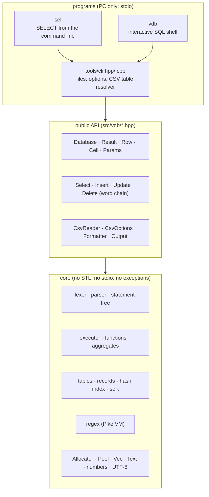

### 2.2 The path of a query

**In plain words.** There are two ways in — SQL text and the C++ word chain — and only one way to understand them:
the word chain *writes SQL text* (with every value escaped) and hands it to the same parser. The parser builds a
statement tree; the executor runs it and pushes rows out, either into a `Result` you keep or into a callback that sees
each row as it is made.

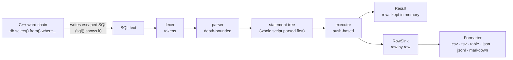

### 2.3 Rows are pushed, one at a time

**In plain words.** The executor does not load a table and then filter it. A *source* (a table, or a CSV file read
lazily) pushes one row at a time through the steps of the query. A filter keeps nothing; `GROUP BY` keeps one record
per group; `ORDER BY` keeps only the rows it must sort. When `LIMIT` has enough rows, it tells the source to stop.

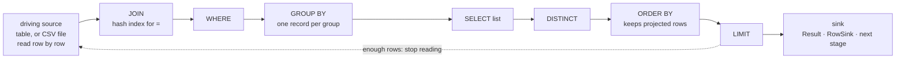

Exact rules (spec A7): a CSV table that the statement reads once, as its first FROM item, is **streamed** — never
loaded. A pipeline stage is the sink of the stage before it. Everything else (a table read twice, a joined table, a
subquery's table) is loaded first.

### 2.4 Flexible values

**In plain words.** Every value is stored as text (or NULL). The *operation* decides how to read it: a math comparison
reads numbers, a quoted literal says "compare as text", and LIKE or REGEXP read text. A math comparison against text
that is not a number is **UNKNOWN**, so the row is simply not returned — never an error, never a silent text match.

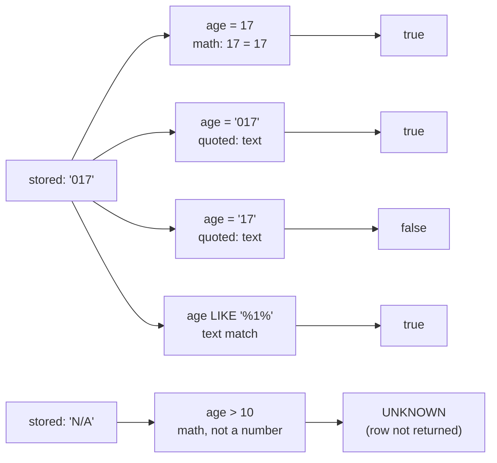

The full rules, with a decision diagram and a truth table measured on real data, are in [§6](#6-flexible-values-in-depth).

### 2.5 Pipelines

**In plain words.** A pipeline is a chain of small queries. Each stage reads what the stage before it produced; inside
a stage, `_` is the name of that previous result. This lets you relate tables step by step, without one big query.

```sql
SELECT customer_id FROM orders.csv WHERE price > 100
|> SELECT name, country FROM customers.csv WHERE id IN _
|> ORDER BY name
```

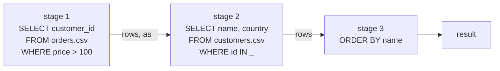

---

## 3. `sel`: a SELECT on the command line

### 3.1 What it is

**In plain words.** Type the SELECT you would write, with `sel` in place of `SELECT`. Every word that is not an
`--option` is part of the query. Files named in FROM and JOIN are read as tables named after the file (`people.csv` is
the table `people`). Without FROM, the CSV comes from stdin.

```
sel [options] <columns> [from <file|->] [join <file> on ...] [where ...] [group by ...] [having ...]
    [order by ...] [limit n] [|> stage ...]
sel [options] -q "full SQL; more SQL"      (INSERT, UPDATE, CREATE, ... too)
sel [options] -f script.sql
```

**Why the name is `sel` and not `select`.** `select` is a reserved word of bash, zsh and sh (it starts a menu loop), so
a program named `select` cannot be called the natural way. Tested:

```
$ bash -c "select name, age from x.csv"
bash: -c: line 0: syntax error near unexpected token `age'
bash: -c: line 0: `select name, age from x.csv'
$ zsh -c "select name, age from x.csv"
zsh:1: parse error near `name,'
$ sh -c "select name, age from x.csv"
sh: -c: line 0: syntax error near unexpected token `age'
sh: -c: line 0: `select name, age from x.csv'
```

A name that needs no shell setup works in scripts, cron and every shell (spec D5).

### 3.2 How your words become SQL

**In plain words.** The shell splits your line into words and removes the outer quotes. `sel` joins the words back
with single spaces and puts `SELECT` in front. Then the database parses that text. A file name in FROM is not a table
yet, so the database asks the *table resolver* of `sel`, which opens the file.

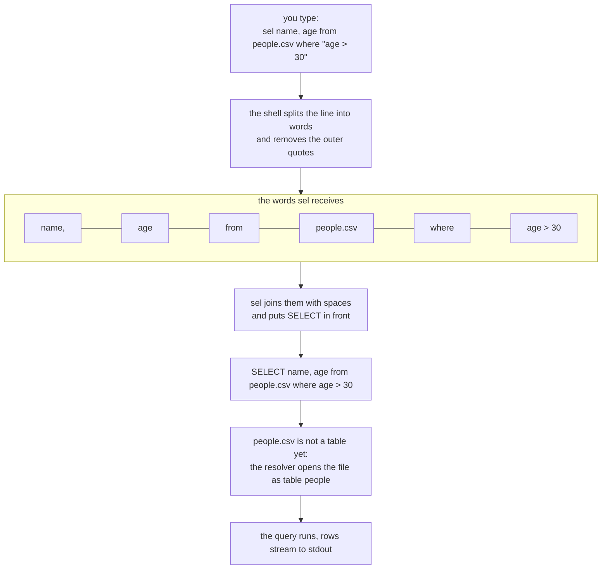

`--show-sql` prints the SQL `sel` built (on stderr), then runs it:

```sh
sel --show-sql name, age from people.csv where "age > 30" order by age desc
```

```
SELECT name, age from people.csv where age > 30 order by age desc
name;age
Davi;45
Fábio;38
Ana;31
```

Exact rules:

- A word that starts with `-` is an option, except `-` alone (stdin as a file) and `-` followed by a digit (a negative
  number). After `--`, every word is query text. Options may come before, between or after the query words.
- When the first word is `select` or `with` (as a word of its own), `sel` does not add another `SELECT`.
- A table name in FROM or JOIN may be a path: `data/people.csv`, `../x.csv`, `~/a.csv`; `"my file.csv"` quotes one.
  Its default alias is the file name without extension (`people`), so `people.name` works.
- `FROM people` (no dot, no table of that name) also finds `people.csv`.
- Files ending in `.tsv` or `.tab` use TAB as the delimiter unless `-d` is given.
- `-`, `stdin` and `_` in FROM read stdin (when it is not a terminal). stdin can be read only once.

### 3.3 Shell safety: quote what the shell would change

**In plain words.** The shell reads your line *before* `sel` does. Some characters mean something to the shell, and it
acts on them instead of passing them on. Put those parts in double quotes. When in doubt, **quote the whole query**.

| You type | What the shell does | Write instead |
|---|---|---|
| `where age > 30` | `>` redirects: the output goes to a **new file named `30`**, and `sel` only sees `where age` | `where "age > 30"` |
| `where age < 30` | `<` reads stdin from a file named `30` (an error if it does not exist) | `where "age < 30"` |
| `where name = 'Ana'` | removes the single quotes: `sel` sees `name = Ana`, and `Ana` looks like a column | `where "name = 'Ana'"` |
| `sel * from x.csv` | replaces `*` with the names of the files in the folder | `sel "*" from x.csv` |
| `count(*)` | bash: syntax error at `(`; zsh: `no matches found` (a glob) | `"count(*)"` |
| `a; b` | `;` ends the command: `b` runs as a new command | `"a; b"` |
| `a | b` | `|` pipes into a program named `b` | `"a | b"` (also needed for `|>` and `||`) |
| `a & b` | `&` runs `a` in the background | `"a & b"` |
| `where "age > 30"` | removes the double quotes, keeps `>` | right |
| `sel "name, age from people.csv where age > 30"` | passes it all as one word | **always right** |

What the shell does to `where age > 30` — the redirection happens before `sel` starts:

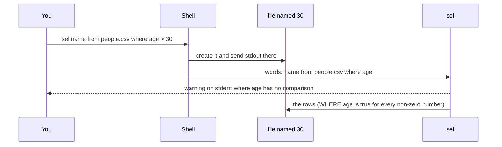

Real run (in a copy of `examples/data`):

```
$ sel name from people.csv where age > 30
sel: warning: "where age" has no comparison. If you typed > or <, the shell took it as a
     redirection (and made a file): quote the condition, e.g. where "age > 30"
$ ls
30
customers.csv
orders.csv
people.csv
prices_br.csv
processes.txt
qso_log.csv
$ cat 30
name
Ana
Carla
Davi
Eva
Fábio
"Gil ""Junior"""
```

The single quotes, lost and kept:

```
$ sel name, age from people.csv where name = 'Ana'
sel: error: no such column: Ana (did you mean age?)
sel: hint: if Ana is a text value, quote it so the shell keeps the quotes: "... = 'Ana'"
$ sel name, age from people.csv where "name = 'Ana'"
name;age
Ana;31
```

`count(*)` without quotes never reaches `sel`:

```
$ bash -c 'sel count(*) from people.csv'
bash: -c: line 0: syntax error near unexpected token `('
bash: -c: line 0: `sel count(*) from people.csv'
$ zsh -c 'sel count(*) from people.csv'
zsh:1: no matches found: count(*)
```

### 3.4 Hints `sel` gives

`sel` recognizes the usual shell accidents and says what to do (spec A20, §7.3):

| Situation | What `sel` prints | Exit |
|---|---|---|
| The words before FROM are exactly the files of the folder (an unquoted `*`) | `the shell replaced * with the names of the files in this folder.` + how to quote it | 2 |
| WHERE or HAVING is followed by one bare word (`where age`) | a warning that a `>` or `<` may have become a redirection | runs |
| A name is not a column and stands where a value would (`= Ana`) | `hint: if Ana is a text value, quote it so the shell keeps the quotes` | 1 |
| A name, table or function is misspelled | `did you mean ...?` with the closest existing name | 1 |
| A stage after `|>` uses a column the previous stage did not select | `hint: a stage after |> sees only the columns the stage before it selected` | 1 |
| A syntax error near a word | `hint: quote the query to keep the shell away from it` | 1 |
| A file has one column and its header holds `,`, TAB or `|` | `note: ... try -d , (or -d auto)` | runs |
| `--memory-limit` was reached | `hint: ... a filter without ORDER BY, GROUP BY or DISTINCT streams the file` | 1 |

Real outputs:

```
$ sel * from people.csv
sel: the shell replaced * with the names of the files in this folder.
     Quote it: sel "*" from ...   (or quote the whole query: sel "* from ...")

$ sel nam from people.csv
sel: error: no such column: nam (did you mean name?)

$ sel name from people.csv where "upr(name) = 'ANA'"
sel: error: no such function: upr (did you mean UPPER?)

$ sel "name from people.csv |> where age > 30"
sel: error: no such column: age (did you mean name?)
sel: hint: a stage after |> sees only the columns the stage before it selected

$ sel "*" from qso_log.csv limit 2
date,time,call,band,mode,rst_sent,rst_rcvd,freq_mhz,country
2026-10-01,14:02,PY2ABC,20m,SSB,59,57,14.205,Brazil
2026-10-01,14:15,LU1XYZ,20m,FT8,-10,-12,14.074,Argentina
sel: note: qso_log.csv has one column; its header holds ',': try -d , (or -d auto)
```

### 3.5 Options

| Option | Meaning | Default |
|---|---|---|
| **Input** | | |
| `-d, --delimiter C` | field delimiter: one character, or `tab`, `comma`, `semicolon`, `colon`, `pipe`, `space`, `auto` (sniffs the header line) | `;` |
| `-r, --regex-delimiter RE` | split fields with a regular expression (e.g. `'\s+'`) | — |
| `-H, --no-header` | files have no header line; columns are `c1`, `c2`, ... | header |
| `--quote C` | quote character; `--quote ""` for none | `"` |
| `--trim` | strip spaces around unquoted fields | off |
| `--empty-text` | unquoted empty fields are `''` instead of NULL | NULL |
| `--decimal-comma` | numbers use a decimal comma (`3,14`), in and out | `.` |
| `--strict` | rows with too few or too many fields, and text after a closing quote, are errors | notes |
| `-t, --table NAME=FILE` | load FILE as table NAME (repeatable) | — |
| **Output** | | |
| `-o, --output FMT` | `csv`, `tsv`, `table`, `json`, `jsonl`, `markdown` | `csv` |
| `-D, --output-delimiter C` | output delimiter (same names as `-d`) | the input delimiter (`;` after `-r` or `-d auto`) |
| `--no-output-header` | no header line | header |
| `--null TEXT` | how NULL is written in csv, tsv, table and markdown | empty |
| **Query** | | |
| `-q, --query SQL` | run full SQL statements (`;`-separated) instead of the select words | — |
| `-f, --file FILE` | run the SQL in FILE | — |
| `--show-sql` | print the SQL built from the words (stderr), then run it | off |
| `--memory-limit SIZE` | stop with an error beyond SIZE bytes (`512K`, `64M`, `2G`) | none |
| `--stats` | rows read, rows written, memory peak and time on stderr | off |
| `--` | everything after it is query text | — |
| **Help** | | |
| `-h, --help` | usage, examples, options | — |
| `--help-sql` | the SQL vDB understands, on one screen | — |
| `--functions` | every function with its number of arguments | — |
| `-V, --version` | the version | — |

`sel --help-sql`:

```
SQL in vDB (full text: spec.md section 3, README)

SELECT [DISTINCT] cols FROM t [AS a] [[INNER|LEFT|RIGHT|FULL|CROSS] JOIN u ON ...|USING (c)]
       [WHERE ...] [GROUP BY ...] [HAVING ...] [ORDER BY x [ASC|DESC] [NULLS FIRST|LAST]]
       [LIMIT n [OFFSET m]]   UNION [ALL] | INTERSECT | EXCEPT   WITH name AS (...) SELECT ...
pipelines:  SELECT ... |> WHERE ... |> SELECT ... |> ORDER BY ... |> LIMIT n   (_ = the previous result)
data:       INSERT INTO t [(a, b)] VALUES (...), (...) | SELECT ...;  UPDATE t SET a = x WHERE ...;
            DELETE FROM t WHERE ...;  CREATE TABLE t (a, b) | AS SELECT ...;  DROP TABLE [IF EXISTS] t

operators:  + - * / %  ||  = <> != < <= > >=  AND OR NOT  IS [NOT] NULL  BETWEEN a AND b
            IN (list | SELECT ... | table)  EXISTS (SELECT ...)  CASE WHEN ... THEN ... ELSE ... END
text match: LIKE 'A%' (_ one char)  ILIKE (any case)  GLOB '*.csv'  SIMILAR TO '(a|b)%'
            REGEXP 'pat' / RLIKE / ~ 'pat' / ~* 'pat' (any case) / !~   CONTAINS(x, 'y')

Numbers and text are flexible: a field is text that reads as a number when the operation
needs one. age > 30 compares numbers (a non-number like 'N/A' does not match);
zip = '01234' compares text (quoted); phone LIKE '%555%' looks for digits as text.
Empty CSV fields are NULL; "" (quoted empty) is the empty text.
```

### 3.6 Input: CSV files

**In plain words.** The first line names the fields; every next line is a record. Fields are split by the delimiter
(`;` unless you say otherwise). A field in double quotes may hold the delimiter, line breaks and quotes (written
twice: `""`).

#### Delimiters

```sh
sel call, band, mode from qso_log.csv where "band = '20m'" -d comma -o table
```

```
+--------+------+------+
| call   | band | mode |
+--------+------+------+
| PY2ABC | 20m  | SSB  |
| LU1XYZ | 20m  | FT8  |
| EA4DEF | 20m  | SSB  |
| VK2GHI | 20m  | FT8  |
+--------+------+------+
(4 rows)
```

`-d auto` looks at the header line and picks one of `;` `,` TAB `|` `:`:

```sh
sel call, freq_mhz from qso_log.csv where "freq_mhz > 14.1" -d auto
```

```
call;freq_mhz
PY2ABC;14.205
JA1QRZ;21.074
EA4DEF;14.250
```

#### A regular expression as the delimiter

Output of tools like `ps` is aligned with runs of spaces. `-r '\s+'` splits on any run of white space
(`examples/data/processes.txt`):

```
PID   USER     CPU  COMMAND
101   root     0.5  init
2047  gustavo  12.0 vdb
3100  gustavo  3.2  sel
```

```sh
sel "*" from processes.txt -r '\s+' -o table
```

```
+------+---------+------+---------+
| PID  | USER    | CPU  | COMMAND |
+------+---------+------+---------+
|  101 | root    |  0.5 | init    |
| 2047 | gustavo | 12.0 | vdb     |
| 3100 | gustavo |  3.2 | sel     |
+------+---------+------+---------+
(3 rows)
```

```sh
sel USER, COMMAND from processes.txt -r '\s+' where "CPU > 1" -o json
```

```
[
{"USER":"gustavo","COMMAND":"vdb"},
{"USER":"gustavo","COMMAND":"sel"}
]
```

#### Quotes and multi-line fields

**In plain words.** A field that starts with the quote character runs until the next lone quote, across delimiters
and line breaks. Two quotes in a row inside it stand for one quote.

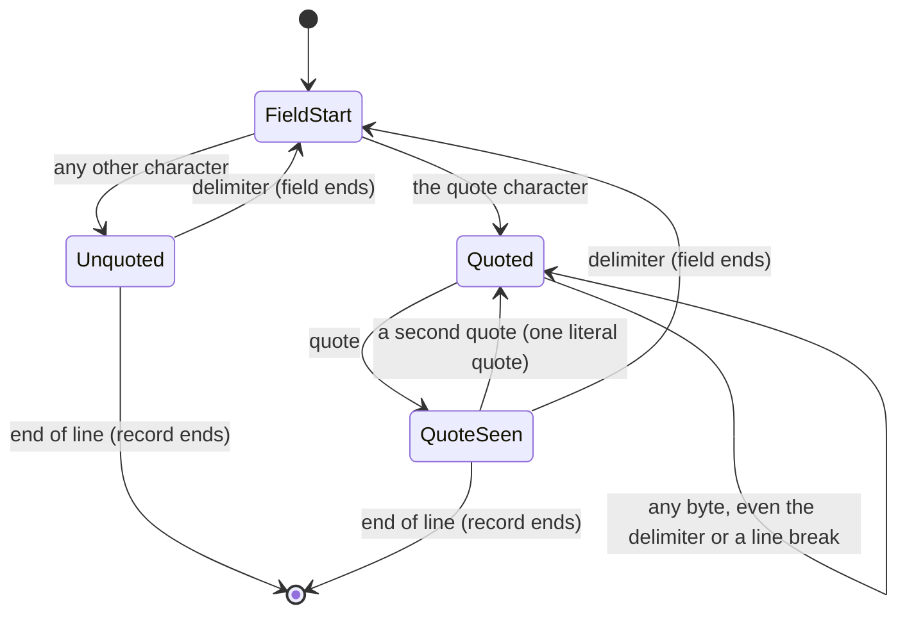

```sh
printf 'id;note\n1;"first line\nsecond line; with a ; inside"\n2;"he said ""73"""\n' > notes.csv
sel "*" from notes.csv -o json
```

```
[
{"id":1,"note":"first line\nsecond line; with a ; inside"},
{"id":2,"note":"he said \"73\""}
]
```

Written back as CSV, the fields are quoted again so the file round-trips:

```sh
sel "id, length(note) as len, note" from notes.csv
```

```
id;len;note
1;39;"first line
second line; with a ; inside"
2;12;"he said ""73"""
```

`--quote C` changes the quote character (`--quote "'"` for single quotes, `--quote ""` for none).

#### Empty fields: NULL or empty text

**In plain words.** An empty field without quotes means "no value" (NULL). A field written as `""` means "a value that
is the empty text". The CSV writer does the reverse, so both meanings survive a round trip (the PostgreSQL rule,
spec A4).

```sh
printf 'a;b\n1;\n2;""\n' > empty.csv
sel "a, b, typeof(b) as t, b is null as isnull" from empty.csv -o table --null NULL
```

```
+---+------+------+--------+
| a | b    | t    | isnull |
+---+------+------+--------+
| 1 | NULL | null |      1 |
| 2 |      | text |      0 |
+---+------+------+--------+
(2 rows)
```

With `--empty-text`, unquoted empty fields are the empty text too:

```
+---+---+------+--------+
| a | b | t    | isnull |
+---+---+------+--------+
| 1 |   | text |      0 |
| 2 |   | text |      0 |
+---+---+------+--------+
(2 rows)
```

And the round trip:

```sh
sel "*" from empty.csv
```

```
a;b
1;
2;""
```

#### Decimal comma

Brazilian and European files write `120,50`. `--decimal-comma` reads such numbers and writes computed reals with a
comma (`examples/data/prices_br.csv`):

```
produto;preço;estoque
Antena;120,50;4
Cabo coaxial;12,00;30
Rádio;899,90;2
```

```sh
sel produto, "preço" from prices_br.csv where "preço > 100" --decimal-comma -o table
sel "produto, preço * estoque as total from prices_br.csv" --decimal-comma
```

```
+---------+--------+
| produto | preço  |
+---------+--------+
| Antena  | 120,50 |
| Rádio   | 899,90 |
+---------+--------+
(2 rows)
produto;total
Antena;482
Cabo coaxial;360
Rádio;1799,8
```

Without `--decimal-comma`, `120,50` is text, so `preço > 100` is UNKNOWN for every row and nothing matches (no error).

#### Byte-order mark, CRLF, odd headers, spaces

Files saved by spreadsheet programs often start with a UTF-8 byte-order mark and end lines with CRLF. Both are handled;
the output uses LF:

```sh
printf '\xef\xbb\xbfcall;band\r\nPY2ABC;20m\r\nW1AW;40m\r\n' > excel.csv
sel "call, band, length(band) as n" from excel.csv -o table
```

```
+--------+------+---+
| call   | band | n |
+--------+------+---+
| PY2ABC | 20m  | 3 |
| W1AW   | 40m  | 3 |
+--------+------+---+
(2 rows)
```

Header names are trimmed of spaces; an empty name becomes `cN` (N = its position); a repeated name gets `_2`, `_3`, ...
A record with fewer fields than the header reads NULL in the rest, and `sel` reports it; `--strict` makes it an error:

```sh
printf ' name ;;name;x\nA;B;C;D\nE;F\n' > odd.csv
sel "*" from odd.csv -o table --null NULL
sel "*" from odd.csv --strict
```

```
+------+----+--------+------+
| name | c2 | name_2 | x    |
+------+----+--------+------+
| A    | B  | C      | D    |
| E    | F  | NULL   | NULL |
+------+----+--------+------+
(2 rows)
sel: note: odd.csv: 1 rows with fewer fields than the header (the missing fields read NULL)

name;c2;name_2;x
A;B;C;D
sel: note: odd.csv: 1 rows with fewer fields than the header (the missing fields read NULL)
sel: error: csv line 3: 2 fields, the header has 4
```

Spaces inside unquoted fields are kept (a number with spaces around it still reads as a number); `--trim` strips them:

```sh
printf 'name , age\n  Ana  , 31 \n Bo ,7\n' > spaced.csv
sel "name, length(name) as n, age, age + 1 as next" from spaced.csv -d , -o table
sel "name, length(name) as n, age" from spaced.csv -d , --trim -o table
```

```
+---------+---+------+------+
| name    | n | age  | next |
+---------+---+------+------+
|   Ana   | 7 |  31  |   32 |
|  Bo     | 4 |    7 |    8 |
+---------+---+------+------+
(2 rows)
+------+---+-----+
| name | n | age |
+------+---+-----+
| Ana  | 3 |  31 |
| Bo   | 2 |   7 |
+------+---+-----+
(2 rows)
```

Exact rules of the reader (spec §5):

- A UTF-8 byte-order mark at the start is skipped. Lines end with LF or CRLF. Empty lines are skipped.
- A field that starts with the quote character is quoted: it ends at the next single quote; `""` inside is one quote;
  it may span lines. Text after the closing quote and before the delimiter is appended (`--strict`: an error).
- Unquoted fields end at the delimiter (a character, or the leftmost non-empty match of the regex delimiter).
- Header names are trimmed; an empty name becomes `cN`; a repeated name gets `_2`, `_3`, ... With `--no-header` the
  names are `c1`, `c2`, ...
- A record with more fields than the header adds columns `cN`; one with fewer leaves NULLs. Both are counted;
  `--strict` makes them errors that name the line.
- An unquoted empty field is NULL, a quoted empty field is the empty text (`--empty-text`: both are empty text).

Exact rules of the writer: fields holding the delimiter, the quote, CR or LF, or starting or ending with a space, are
quoted; NULL is written empty, the empty text as `""`; lines end with LF.

### 3.7 Output formats

**In plain words.** `-o` picks how the rows are written. `csv` is the default (with the input delimiter); `table` is
for people; `json` and `jsonl` are for programs; `markdown` is for documents.

| Format | Streams | Rules |
|---|---|---|
| `csv` | yes | the CSV writer above; header line unless `--no-output-header` |
| `tsv` | yes | `csv` with TAB |
| `table` | no (measures widths first) | a box of `+ - |`, numbers right-aligned, widths in UTF-8 characters, `(N rows)` footer |
| `json` | yes | an array of objects; a value whose text is a JSON number is written as a number, NULL as `null`, anything else as a string with escapes |
| `jsonl` | yes | one object per line |
| `markdown` | yes | a GitHub table; `|` in a value is escaped |

The same query in each format — `sel name, age, email from people.csv where "name in ('Ana', 'Bruno')" -o FMT`:

`-o csv`

```
name;age;email
Ana;31;ana@example.org
Bruno;N/A;
```

`-o tsv`

```
name	age	email
Ana	31	ana@example.org
Bruno	N/A	
```

`-o table`

```
+-------+-----+-----------------+
| name  | age | email           |
+-------+-----+-----------------+
| Ana   |  31 | ana@example.org |
| Bruno | N/A |                 |
+-------+-----+-----------------+
(2 rows)
```

`-o json`

```
[
{"name":"Ana","age":31,"email":"ana@example.org"},
{"name":"Bruno","age":"N/A","email":null}
]
```

`-o jsonl`

```
{"name":"Ana","age":31,"email":"ana@example.org"}
{"name":"Bruno","age":"N/A","email":null}
```

`-o markdown`

```
| name | age | email |
| --- | --- | --- |
| Ana | 31 | ana@example.org |
| Bruno | N/A |  |
```

`-D , --null '(none)'`

```
name,age,email
Ana,31,ana@example.org
Bruno,N/A,(none)
```

In JSON, only text that is a valid JSON number becomes a number: Carla's age `017` stays a string, while a computed
`age + 0` is the number 17:

```
$ sel name, age, "age + 0 as n" from people.csv where "name = 'Carla'" -o jsonl
{"name":"Carla","age":"017","n":17}
```

An expression without `AS` is named after its text; repeated names get `_2`:

```
$ sel name, "upper(name)", "age + 1", age from people.csv limit 1
name;upper(name);age + 1;age
Ana;ANA;32;31
```

### 3.8 Joins across files

**In plain words.** Name a second file after JOIN and say how rows match after ON. Give each file a short alias
(`o`, `c`) to name its columns. An equality in ON makes `sel` build a hash index, so two large files join fast.

```sh
sel "c.name, o.product" from customers.csv c left join orders.csv o on "o.customer_id = c.id" order by c.name -o table --null NULL
```

```
+------+--------------+
| name | product      |
+------+--------------+
| Ana  | antenna      |
| Ana  | coax cable   |
| Davi | radio        |
| Eva  | antenna      |
| Eva  | power supply |
| Zoe  | NULL         |
+------+--------------+
(6 rows)
```

```sh
sel "c.name, count(o.id) as orders, sum(o.quantity * o.price) as spent" from customers.csv c left join orders.csv o on "o.customer_id = c.id" group by c.name order by spent desc -o table --null NULL
```

```
+------+--------+-------+
| name | orders | spent |
+------+--------+-------+
| Davi |      1 | 899.9 |
| Eva  |      2 |   391 |
| Ana  |      2 | 156.5 |
| Zoe  |      0 | NULL  |
+------+--------+-------+
(4 rows)
```

```sh
sel "c.name, o.id, o.product" from customers.csv c full join orders.csv o on "o.customer_id = c.id" -o table --null NULL
```

```
+------+------+--------------+
| name | id   | product      |
+------+------+--------------+
| Ana  |  100 | antenna      |
| Ana  |  101 | coax cable   |
| Davi |  102 | radio        |
| Eva  |  103 | antenna      |
| Eva  |  104 | power supply |
| Zoe  | NULL | NULL         |
| NULL |  105 | tuner        |
+------+------+--------------+
(7 rows)
```

Without aliases, the table name is the file name without its extension:

```
$ sel "orders.product, customers.name" from orders.csv join customers.csv on "orders.customer_id = customers.id" limit 2
product;name
antenna;Ana
coax cable;Ana
```

A file may be joined with itself under two aliases:

```
$ sel "a.name, b.name as same_city from people.csv a join people.csv b on a.city = b.city and a.name < b.name" -o table
+-------+-----------+
| name  | same_city |
+-------+-----------+
| Ana   | Davi      |
| Bruno | Fábio     |
+-------+-----------+
(2 rows)
```

The join kinds are in [§7.8](#78-joins).

### 3.9 Pipelines, stdin and shell pipes

**In plain words.** There are two ways to chain steps. Inside one `sel`, use `|>` (quote it). Between programs, use
the shell pipe `|`: `sel` writes CSV, and the next `sel` reads it from stdin as the table `_`.

A pipeline inside one `sel`:

```sh
sel "name, age from people.csv |> where age > 30 |> select name |> order by name"
```

```
name
Ana
Davi
Fábio
```

Relating two files without a JOIN:

```sh
sel "customer_id from orders.csv where price > 100 |> select name, country from customers.csv where id in _ |> order by name" -o table
```

```
+------+---------+
| name | country |
+------+---------+
| Ana  | BR      |
| Davi | BR      |
| Eva  | PT      |
+------+---------+
(3 rows)
```

CSV from stdin — without FROM, or with `from -`:

```sh
cat people.csv | sel name where "city like 'Rio%'"
sel "count(*) as n" < people.csv
cat orders.csv | sel product, price from - where "price > 100"
```

```
name
Ana
Davi
n
7
product;price
antenna;120.50
radio;899.90
antenna;120.50
power supply;150.00
tuner;210.00
```

Between `sel` programs:

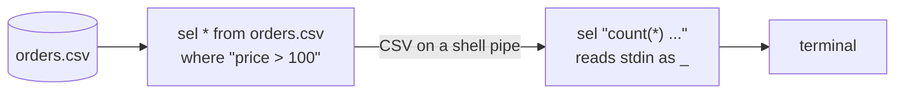

```sh
sel "*" from orders.csv where "price > 100" | sel "count(*) as big_orders, sum(price) as total"
sel name, age from people.csv where "age > 20" | sel name from _ where "name like '%a%'" order by name
```

```
big_orders;total
5;1500.9
name
Ana
Davi
Eva
```

Exact rule (spec A9): a SELECT **without FROM** reads `_`. In `sel` and `vdb`, `_` is stdin when stdin is not a
terminal; with a terminal it gives one row (`SELECT 1 + 1`). In a script or cron job, where stdin is not a terminal, a
SELECT without FROM (also inside a subquery) therefore reads stdin.

### 3.10 Full SQL: `-q`, `-t`, `-f`

`-q` runs any statements (`;`-separated); `-t NAME=FILE` loads a file under a name of your choice; FROM may still name
files directly. Changes stay in memory: the file is never written.

```sh
sel -q "UPDATE people SET age = age + 1 WHERE age > 40; SELECT name, age FROM people WHERE age > 40" -t people=people.csv
```

```
name;age
Davi;46
```

`-f` runs a SQL file:

```sh
printf "SELECT country, COUNT(*) AS n\nFROM customers.csv\nGROUP BY country\nORDER BY n DESC;\n" > by_country.sql
sel -f by_country.sql -o table
```

```
+---------+---+
| country | n |
+---------+---+
| BR      | 2 |
| PT      | 1 |
| US      | 1 |
+---------+---+
(3 rows)
```

`--` ends the options, so a query word may start with `-`:

```sh
sel -o jsonl -- name, "-1 * length(name) as neg" from customers.csv limit 2
```

```
{"name":"Ana","neg":-3}
{"name":"Davi","neg":-4}
```

### 3.11 Big files: streaming, `--memory-limit`, `--stats`

**In plain words.** A filter (WHERE, LIMIT, a projection) over a file that is read once never loads the file: rows are
read, tested and written one at a time, so memory stays in kilobytes whatever the file size. GROUP BY keeps one record
per group. ORDER BY and DISTINCT must keep the rows they sort or compare. `--stats` shows what happened;
`--memory-limit` turns "too much memory" into a clean error.

A file with one million rows (15 MB):

```sh
awk 'BEGIN{print "id;sensor;value"; for(i=1;i<=1000000;i++) printf "%d;s%d;%.2f\n", i, i%10, (i*37)%1000/10.0}' > big.csv
sel "count(*) as n, avg(value) as avg" from big.csv where "value > 90" --stats
```

```
n;avg
99000;95
sel: 1000000 rows read, 1 rows written, memory peak 82992 bytes, 0.076 s
```

`LIMIT` stops reading as soon as it has its rows:

```sh
sel id, value from big.csv where "value > 99.8" limit 3 --stats
```

```
id;value
27;99.90
1027;99.90
2027;99.90
sel: 2027 rows read, 3 rows written, memory peak 77968 bytes, 0.000 s
```

GROUP BY keeps one record per group:

```sh
sel sensor, "count(*) as n" from big.csv group by sensor order by sensor limit 3 --memory-limit 1M --stats
```

```
sensor;n
s0;100000
s1;100000
s2;100000
sel: 1000000 rows read, 3 rows written, memory peak 87313 bytes, 0.065 s
```

ORDER BY keeps every projected row, so a limit stops it with a hint:

```sh
sel id, value from big.csv order by value desc limit 3 --memory-limit 1M --stats
```

```
id;value
sel: 24130 rows read, 0 rows written, memory peak 1048550 bytes, 0.003 s
sel: error: out of memory
sel: hint: the --memory-limit was reached; a filter without ORDER BY, GROUP BY or DISTINCT
     streams the file and needs little memory
```

The same query without the limit needs about 119 MB for the million rows
(`memory peak 119044954 bytes`). Times depend on your machine; the row counts and the shape of the memory use do not.

### 3.12 Exit codes

| Code | Meaning | Example |
|---|---|---|
| 0 | success | any query that ran, even with zero rows |
| 1 | SQL or data error | `no such column: nam (did you mean name?)`, `out of memory`, `csv line 3: ...` |
| 2 | usage error | `unknown option --bogus`, `unknown output format 'xml'`, an unquoted `*`, no query at all |
| 3 | file error | `cannot open nofile.csv: No such file or directory` |

---

## 4. `vdb`: the interactive shell

**In plain words.** `vdb` is a SQL prompt over the same engine. Load CSV files (or name them in FROM), type SQL ending
with `;`, and read the answer. It also runs SQL files and single commands, so it fits in scripts.

```
vdb [options] [script.sql ...]   run scripts, then read SQL from stdin
vdb [options] -c "SQL"           run SQL and exit
```

| Option | Meaning |
|---|---|
| `-c, --command SQL` | run SQL and exit |
| `-t, --table NAME=FILE` | load a CSV file as table NAME (repeatable) |
| `-o, --output FMT` | `csv`, `tsv`, `table`, `json`, `jsonl`, `markdown` (default: `table` on a terminal, `csv` otherwise) |
| `-d`, `-r`, `-H`, `-D`, `--quote`, `--trim`, `--empty-text`, `--decimal-comma`, `--strict`, `--null`, `--no-output-header`, `--memory-limit` | as in `sel` |
| `-h, --help` | the help text |

Statements end with `;` and may span lines (the prompt becomes `...>`). FROM may name CSV files as in `sel`
(`FROM people.csv`, or `FROM people` when `people.csv` exists). Exit status: 0 when every statement ran, 1 when one
failed, 2 for a usage error, 3 when a `-t` file or a script cannot be read.

### 4.1 Dot commands

| Command | What it does |
|---|---|
| `.help` | the list of dot commands |
| `.tables` | the tables and their sizes |
| `.schema [TABLE]` | the columns of a table (or of all) |
| `.load FILE [NAME]` | load a CSV file as a table (named after the file) |
| `.save TABLE FILE` | write a table as CSV (with the output delimiter) |
| `.mode FMT` | `csv`, `tsv`, `table`, `json`, `jsonl`, `markdown` |
| `.delimiter C` | input delimiter for `.load` and FROM files (`tab`, `comma`, ...) |
| `.headers on\|off` | header line in csv, tsv, table and markdown |
| `.nullvalue TEXT` | how NULL is shown |
| `.timer on\|off` | time each statement |
| `.read FILE` | run the SQL in FILE |
| `.quit` | leave (also `.exit` or Ctrl-D) |

### 4.2 A session

Recorded on a terminal in `examples/data`:

```
vDB 1.0.0 - type SQL ending with ';', or .help
vdb> .load people.csv
loaded people: 7 rows, 5 columns
vdb> .load orders.csv
loaded orders: 6 rows, 5 columns
vdb> .tables
people                   7 rows, 5 columns
orders                   6 rows, 5 columns
vdb> .schema people
people (7 rows): name, age, city, phone, email
vdb> SELECT name, age FROM people WHERE age > 30 ORDER BY age DESC;
+-------+-----+
| name  | age |
+-------+-----+
| Davi  |  45 |
| Fábio |  38 |
| Ana   |  31 |
+-------+-----+
(3 rows)
vdb> SELECT product, SUM(quantity * price) AS revenue
...>   FROM orders GROUP BY product ORDER BY revenue DESC
...>   |> LIMIT 3;
+---------+---------+
| product | revenue |
+---------+---------+
| radio   |   899.9 |
| antenna |   361.5 |
| tuner   |     210 |
+---------+---------+
(3 rows)
vdb> .mode json
vdb> SELECT name, city FROM people WHERE city ILIKE 'são%';
[
{"name":"Bruno","city":"São Paulo"},
{"name":"Fábio","city":"São Paulo"}
]
vdb> .quit
```

`ILIKE 'são%'` matched `São`: case folding covers Latin-1 letters in UTF-8 (spec A12).

A script with `.delimiter`, `.save` and `.headers` (`vdb < script.txt`, output mode set with `.mode`):

```
.delimiter comma
.load qso_log.csv qso
.mode table
.nullvalue NULL
SELECT band, COUNT(*) AS qsos, GROUP_CONCAT(DISTINCT mode, '/') AS modes FROM qso GROUP BY band ORDER BY qsos DESC;
CREATE TABLE dx AS SELECT call, country FROM qso WHERE country <> 'Brazil';
.save dx dx.csv
.headers off
SELECT * FROM dx LIMIT 2;
```

```
loaded qso: 7 rows, 9 columns
+------+------+---------+
| band | qsos | modes   |
+------+------+---------+
| 20m  |    4 | SSB/FT8 |
| 40m  |    2 | CW/SSB  |
| 15m  |    1 | FT8     |
+------+------+---------+
(3 rows)
saved 5 rows to dx.csv
+--------+---------------+
| LU1XYZ | Argentina     |
| W1AW   | United States |
+--------+---------------+
(2 rows)
```

One command, for scripts:

```sh
vdb -c "SELECT country, COUNT(*) AS n FROM customers GROUP BY country ORDER BY n DESC" -o markdown
vdb -t c=customers.csv -c "SELECT name FROM c WHERE country = 'BR'"
```

```
| country | n |
| --- | --- |
| BR | 2 |
| PT | 1 |
| US | 1 |
name
Ana
Davi
```

---

## 5. The C++ library

### 5.1 Add it to your project

**In plain words.** vDB is plain C++11 source with no dependencies. Add `src/` to the include path and compile the
`.cpp` files of `src/vdb/` with your program — or build the static library once.

| Way | How |
|---|---|
| Sources | `c++ -std=c++11 -Isrc my_program.cpp src/vdb/*.cpp -o my_program` |
| Static library | `make lib` → `build/libvdb.a`; then `c++ -std=c++11 -Isrc my_program.cpp build/libvdb.a -o my_program` |
| Arduino | `#include <vdb.h>` and give the repository as a library: `arduino-cli compile --library /path/to/vDB ...` (what `make arduino_check` does); every `.cpp` under `src/` is compiled |

One include gives everything: `#include <vdb.h>` (or `"vdb/vdb.hpp"`). Everything is in the namespace `vdb`.

### 5.2 The first program

```cpp
// examples/pc/01_first_query.cpp
#include <stdio.h>

#include <vdb.h>

int main() {
    vdb::Database db;  // lives in memory, uses the heap

    db.exec("CREATE TABLE people (name, age, city)");
    db.exec("INSERT INTO people VALUES ('Ana', 31, 'Rio'), ('Bruno', 'N/A', 'Sao Paulo'), ('Carla', 17, 'Recife')");

    vdb::Result r = db.query("SELECT name, age FROM people WHERE age > 18 ORDER BY name");
    if (!r.ok()) {
        printf("error: %s\n", r.error());
        return 1;
    }
    printf("%zu adult(s):\n", r.size());
    for (size_t i = 0; i < r.size(); ++i) {
        printf("  %s is %lld\n", r[i]["name"].text(), static_cast<long long>(r[i]["age"].integer()));
    }
    // Bruno's age is 'N/A': a math comparison only matches numbers, so he is not listed (and not an error).
    return 0;
}
```

```
1 adult(s):
  Ana is 31
```

### 5.3 SQL text: `query`, `exec`, `run`

**In plain words.** Three calls run SQL text. `query` gives you the answer as an object. `exec` is for statements whose
rows you do not need. `run` hands each row to your code as it is produced, so nothing is kept in memory.

| Call | Returns | Use it for |
|---|---|---|
| `Result query(sql [, params])` | the last statement's rows (or `changes()`), or the first error | most questions |
| `Status exec(sql [, params])` | success or the first error; rows are discarded | CREATE, INSERT, UPDATE, DELETE, DROP |
| `Status run(sql, [params,] RowSink& sink)` | success or the first error; every SELECT's rows go to `sink` | large results, streaming, early stop |

A *script* is one or more statements separated by `;`. The whole script is parsed before the first statement runs: a
syntax error anywhere changes nothing.

A `RowSink` gets `begin` (the column names), `row` per row and `end`, once per SELECT of the script. `row` returning
`false` stops reading — a CSV source then stops too.

```cpp
struct Printer : vdb::RowSink {
    bool begin(size_t columns, const char* const* names) override {
        for (size_t i = 0; i < columns; ++i) printf("%s%s", i ? " | " : "", names[i]);
        printf("\n");
        return true;  // false: skip this statement
    }
    bool row(const vdb::Row& row) override {
        for (size_t i = 0; i < row.size(); ++i) printf("%s%s", i ? " | " : "", row[i].text());
        printf("\n");
        return true;  // false: stop reading rows
    }
    void end() override { printf("(end)\n"); }
};

vdb::Database db;
db.exec("CREATE TABLE people (name, age, city)");
db.exec("INSERT INTO people VALUES ('Ana', 31, 'Rio'), ('Bo', 'N/A', NULL)");
Printer printer;
vdb::Status s = db.run("SELECT name, age FROM people; SELECT COUNT(*) AS n FROM people", printer);
```

```
name | age
Ana | 31
Bo | N/A
(end)
n
2
(end)
```

`examples/pc/07_streaming_sink.cpp` feeds a million generated rows through a sink that stops after 3:

```
columns: n square
  n=7 square=49
  n=14 square=196
  n=21 square=441
rows read from the source: 21 of 1000000 (the sink stopped the query)
```

### 5.4 Results: `Result`, `Row`, `Cell`

**In plain words.** A `Result` owns its rows. `r[i]` is a row; `row["name"]` or `row[0]` is a cell; a cell gives its
value as text, as an integer or as a real. Asking for a row or a column that does not exist gives a NULL cell — never
a crash — and so does reading a failed result.

| Type | Members |
|---|---|
| `Result` | `ok()`, `explicit operator bool`, `error()`, `error_code()`, `status()`, `size()` (rows), `columns()`, `column_name(i)`, `column_index(name)` (-1 if absent), `operator[](row)`, `changes()` (rows inserted, updated or deleted), `write(Output&, FormatOptions)`. Movable, not copyable. It may outlive the `Database` while the allocator lives. |
| `Row` | `size()`, `operator[](index)`, `operator[](name)` (case-insensitive), `column_name(i)` |
| `Cell` | `text()` (never null: `""` for NULL), `is_null()`, `is_number()`, `integer(fallback = 0)`, `number(fallback = 0.0)`, `size()` (bytes) |
| `Status` | `ok()`, `code()`, `message()` |

```cpp
vdb::Result r = db.query("SELECT name, age, city FROM people ORDER BY name");
for (size_t i = 0; i < r.size(); ++i) {
    vdb::Row row = r[i];
    printf("%s: age is_number=%d integer(-1)=%lld city is_null=%d\n", row["name"].text(), row["age"].is_number(),
           (long long)row["age"].integer(-1), row["city"].is_null());
}

vdb::Result none = db.query("SELECT name FROM people WHERE name = 'nobody'");  // zero rows
printf("none: size=%zu none[5][\"name\"].is_null()=%d text()='%s' integer(-1)=%lld\n", none.size(),
       none[5]["name"].is_null(), none[5]["name"].text(), (long long)none[5]["name"].integer(-1));

vdb::Result bad = db.query("SELEC name FROM people");
printf("bad: ok=%d size=%zu cell='%s'\nerror: %s\n", bad.ok(), bad.size(), bad[0][0].text(), bad.error());

vdb::Result c = db.query("UPDATE people SET age = 32 WHERE name = 'Ana'");
printf("changes=%zu column_index(\"AGE\")=%d\n", c.changes(), r.column_index("AGE"));
```

```
Ana: age is_number=1 integer(-1)=31 city is_null=0
Bo: age is_number=0 integer(-1)=-1 city is_null=1
none: size=0 none[5]["name"].is_null()=1 text()='' integer(-1)=-1
bad: ok=0 size=0 cell=''
error: syntax error at line 1, column 1 near "SELEC": expected a statement (SELECT, INSERT, UPDATE, DELETE, CREATE, DROP)
changes=1 column_index("AGE")=1
```

### 5.5 The word chain

**In plain words.** The word chain is SQL written with C++ method calls, read left to right like the sentence it
builds. `where` is a member (no parentheses): `.where.field("age").gt(30)`. Every name you pass is quoted as an
identifier and every value as a literal (quotes doubled), and the chain *writes SQL text* that the one parser compiles.
`sql()` shows that text, so the chain is also a way to learn SQL.

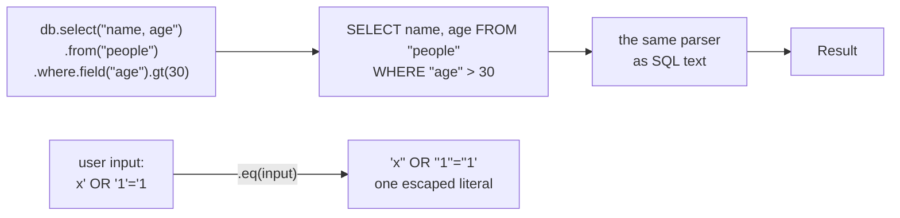

From `examples/pc/02_word_chain.cpp`:

```cpp
vdb::Database db;
db.insert("people").value("name", "Ana").value("age", 31).value("city", "Rio")
    .row().value("name", "Davi").value("age", 45).value("city", "Rio")
    .row().value("name", "Eva").value("age", 22).value("city", "Porto Alegre")
    .run();

vdb::Select q = db.select("name, age")
                    .from("people")
                    .where.field("age").gt(30)
                    .and_().field("name").like("A%")
                    .order_by("age", vdb::DESC)
                    .limit(10);
printf("SQL: %s\n", q.sql());
vdb::Result r = q.run();

// Values are always escaped: this name cannot break the query.
const char* typed_by_a_user = "x' OR '1'='1";
db.select().from("people").where.field("name").eq(typed_by_a_user).run();  // 0 rows

// Grouping with open() and close(), IN, an UPDATE and a DELETE.
db.select("name").from("people")
    .where.open().field("city").eq("Rio").or_().field("age").lt(25).close()
    .and_().field("name").in("Ana", "Eva")
    .run();
db.update("people").set("age", 46).where.field("name").eq("Davi").run();
db.delete_from("people").where.field("age").lt(18).run();
```

```
SQL: SELECT name, age FROM "people" WHERE "age" > 30 AND "name" LIKE 'A%' ORDER BY age DESC LIMIT 10
  Ana | 31
SQL: SELECT * FROM "people" WHERE "name" = 'x'' OR ''1''=''1'
  0 rows: the input stayed a value
(city = Rio OR age < 25) AND name IN (Ana, Eva):
  Ana
  Eva
after the update and the delete:
  Ana | 31
  Davi | 46
  Eva | 22
```

More chains and the SQL they write (real `sql()` output):

| Chain | `sql()` |
|---|---|
| `db.select("c.name, o.product").from("customers", "c").join("orders", "o").on.field("o", "customer_id").eq(vdb::column("c", "id")).where.field("o", "total").between(100, 500).order_by("c.name")` | `SELECT c.name, o.product FROM "customers" AS "c" JOIN "orders" AS "o" ON "o"."customer_id" = "c"."id" WHERE "o"."total" BETWEEN 100 AND 500 ORDER BY c.name` |
| `db.select("name").from("customers").where.not_().field("country").in("BR", "PT")` | `SELECT name FROM "customers" WHERE NOT "country" IN ('BR', 'PT')` |
| `db.select("country, COUNT(*) AS n").from("customers").group_by("country").having.expr("COUNT(*)").gt(1)` | `SELECT country, COUNT(*) AS n FROM "customers" GROUP BY country HAVING COUNT(*) > 1` |
| `db.select("customer_id").from("orders").where.field("total").gt(200).then().select("name").from("customers").where.field("id").in_table("_")` | `SELECT customer_id FROM "orders" WHERE "total" > 200 \|> SELECT name FROM "customers" WHERE "id" IN "_"` |
| `db.select().from("customers").where.field("name").contains("v").and_().field("id").is_not_null().limit(2).offset(1)` | `SELECT * FROM "customers" WHERE CONTAINS("name", 'v') AND "id" IS NOT NULL LIMIT 2 OFFSET 1` |
| `db.select("name").from("people").where.field("age").gt(18).field("age").lt(65).order_by("city").order_by("age", vdb::DESC)` | `SELECT name FROM "people" WHERE "age" > 18 AND "age" < 65 ORDER BY city, age DESC` |
| `db.select("city, COUNT(*) AS n").from("people").group_by("city").having.expr("COUNT(*)").ge(2).order_by("n", vdb::DESC).then().where.field("n").lt(10).then().limit(3)` | `SELECT city, COUNT(*) AS n FROM "people" GROUP BY city HAVING COUNT(*) >= 2 ORDER BY n DESC \|> WHERE "n" < 10 \|> LIMIT 3` |
| `db.insert("people").value("name", "Lia").value("age", 2.5).value("city", none).value("ok", true)` (`none` is a null `const char*`) | `INSERT INTO "people" ("name", "age", "city", "ok") VALUES ('Lia', 2.5, NULL, TRUE);` |
| `db.update("orders").set("total", 40.25).where.field("id").eq(101)` | `UPDATE "orders" SET "total" = 40.25 WHERE "id" = 101` |
| `db.delete_from("orders").where.field("total").lt(50)` | `DELETE FROM "orders" WHERE "total" < 50` |
| `db.select("name").from("customers").where.field("id").gt(vdb::raw("1 + 1"))` | `SELECT name FROM "customers" WHERE "id" > 1 + 1` |

Every method:

| Part | Methods |
|---|---|
| start | `db.select(cols = "*")`, `db.insert(table)`, `db.update(table)`, `db.delete_from(table)` |
| `Select` | `distinct()`, `from(table [, alias])`, `join` / `left_join` / `right_join` / `full_join` / `cross_join(table [, alias])` then `.on` (a condition), `.where`, `group_by(cols)`, `.having`, `order_by(col [, vdb::ASC \| vdb::DESC])` (repeatable), `limit(n)`, `offset(n)`, `then()` (ends a stage: `\|>`) followed by `select(cols)`, `from()`, `.where`, ...; `sql()`, `run()`, `run(RowSink&)` |
| condition (`where`, `having`, `on`) | operands: `field(name)`, `field(table, name)`, `expr(raw_sql)`; comparisons: `eq ne lt le gt ge`, `between(a, b)`, `in(a, b, ...)`, `not_in(...)`, `in_query(sql)`, `in_table(name)`, `is_null()`, `is_not_null()`; text: `like`, `not_like`, `ilike`, `glob`, `regexp`, `not_regexp`, `similar_to`, `contains`, `starts_with`, `ends_with`; connectors: `and_()`, `or_()`, `not_()`, `open()`, `close()`; then any method of the statement it belongs to |
| values | `const char*` (text; a null pointer is NULL), integers, `float` / `double`, `bool`, `vdb::column("x")` or `vdb::column("t", "x")` (another field), `vdb::raw("x * 2")` (trusted SQL) |
| `Insert` | `value(name, v)` ... `row()` (next record) ... `run()`, `sql()` |
| `Update` | `set(name, v)` ..., `.where`, `run()`, `sql()` |
| `Delete` | `.where`, `run()`, `sql()` |

Exact rules (spec D1, A1, §4.2):

- AND binds before OR; `open()` / `close()` group. Two conditions in a row are joined with AND.
- `field()`, `from()`, `join()`, `set()` and `value()` quote names; values are written as literals with quotes doubled.
- Only `expr()`, `raw()`, `select(cols)`, `group_by(cols)`, `order_by(col)` and `in_query(sql)` take SQL text as given —
  **never pass user input there**; pass it as a value.
- A misuse (`gt()` without a field, `close()` without `open()`, two `field()` without an operator) makes `run()` return
  an error, for example `word chain: a comparison needs field() or expr() first`.
- `vdb::Select q = db.select()...;` copies the chain, so a query can be built in steps.

### 5.6 Parameters: `?` and `?N`

**In plain words.** When you write SQL text and need to put a user's value in it, never paste the value into the text.
Write `?` where it goes and give the value in `Params`; it stays a value, whatever it contains.

```cpp
// examples/pc/09_params_safe.cpp
const char* typed = "nobody' OR '1'='1";  // a hostile input
vdb::Result r = db.query("SELECT name FROM users WHERE name = ?", vdb::Params().add(typed));
printf("rows for the hostile input: %zu\n", r.size());  // 0: it is only a value

r = db.query("SELECT name FROM users WHERE name = ?1 OR name = ?2 ORDER BY name", vdb::Params().add("ana").add("bruno"));
for (size_t i = 0; i < r.size(); ++i) printf("found %s\n", r[i][0].text());

r = db.query("SELECT name FROM users WHERE name = ?");
printf("missing value: %s\n", r.error());
```

```
rows for the hostile input: 0
found ana
found bruno
missing value: the SQL uses 1 parameters but 0 values were given
```

- `?` takes the next value; `?N` the N-th (from 1).
- `add(const char*)`, `add(text, length)`, `add(int / long / long long / unsigned ...)`, `add(double)`, `add(bool)`,
  `add_null()`. A text parameter is *flexible* text (it reads as a number where an operation needs one, §6).
- `Params()` uses the heap; `Params(allocator)` uses your allocator (the ESP32 sketch passes its arena).

### 5.7 CSV in the library

**In plain words.** The library never opens files (a microcontroller may have none). You give it bytes through a
`ByteSource` — a file, a serial port, a string — and it reads CSV from them, either all at once into a table or lazily,
one row per request.

| API | What it does |
|---|---|
| `CsvOptions` | `delimiter` (`';'`), `delimiter_regex` (0), `auto_delimiter`, `quote` (`'"'`), `header` (true), `trim`, `empty_text`, `strict` |
| `ByteSource` | your class: `size_t read(char* buffer, size_t size)` returns 0 at the end. `TextSource(text [, length])` reads a string. |
| `db.load_csv(table, source, options)` | reads everything into a new table |
| `db.load_csv_text(table, text, options)` | the same from a string |
| `CsvReader(allocator, source, options)` + `open()` | a lazy reader: `column_count()`, `column_name(i)`, `records()`, `line()`, `short_rows()`, `long_rows()`, `delimiter()` |
| `db.attach_csv(table, reader)` | a table read lazily: streamed when a statement reads it once (§2.3), loaded otherwise |

From a string, with a regex delimiter (`examples/pc/06_csv_in_memory.cpp`):

```cpp
vdb::Database db;
vdb::CsvOptions semicolons;  // ';' is the default delimiter
db.load_csv_text("radios", "model;band;watts\nIC-705;HF/VHF/UHF;10\nIC-7300;HF/6m;100\nX6200;HF/6m;8\n", semicolons);

vdb::CsvOptions spaces;
spaces.delimiter_regex = "\\s+";  // columns split by any run of spaces
db.load_csv_text("ps", "PID   USER     CPU\n101   root     0.5\n2047  gustavo  12.0\n", spaces);
```

From a file:

```cpp
struct FileSource : vdb::ByteSource {
    FILE* file;
    explicit FileSource(FILE* f) : file(f) {}
    size_t read(char* buffer, size_t size) override { return fread(buffer, 1, size, file); }
};

FILE* f = fopen("orders.csv", "rb");
FileSource source(f);
vdb::Status st = db.load_csv("orders", source, vdb::CsvOptions());
fclose(f);
// st.ok(), db.table("orders")->row_count() == 6
```

Lazily, so a filter or a `LIMIT` reads only what it needs:

```cpp
FILE* g = fopen("people.csv", "rb");
FileSource gs(g);
vdb::CsvReader reader(db.allocator(), gs, vdb::CsvOptions());
reader.open();                     // reads the header
db.attach_csv("folks", reader);    // nothing loaded yet
vdb::Result first = db.query("SELECT name FROM folks LIMIT 2");
// first.size() == 2, reader.records() == 2: two records were read
```

The source and the reader must live as long as the table may be read.

### 5.8 Writing output: `Output`, `Formatter`, `FormatOptions`

**In plain words.** The library has no `printf`. To print, give it an `Output`: a class with one `write(text, length)`
method that sends bytes wherever you want (stdout, a file, `Serial`). `Result::write` prints a whole result;
`Formatter` is a `RowSink` that prints rows as they come.

| API | What it does |
|---|---|
| `Output` | your class: `void write(const char* text, size_t length)`; `TextOutput(allocator)` collects into memory (`c_str()`, `size()`) |
| `FormatOptions` | `format` (`k_format_csv`, `k_format_tsv`, `k_format_table`, `k_format_json`, `k_format_jsonl`, `k_format_markdown`), `delimiter` (`';'`), `quote`, `header` (true), `null_text` (`""`) |
| `parse_format(name, format)` | `"json"` → `k_format_json`, ... |
| `result.write(out, options)` | writes a whole `Result` |
| `Formatter(out, options, allocator)` | a `RowSink`: give it to `db.run()`; `rows()` counts what it wrote |

```cpp
struct StdoutOutput : vdb::Output {
    void write(const char* text, size_t length) override { fwrite(text, 1, length, stdout); }
};

StdoutOutput out;
vdb::FormatOptions table;
table.format = vdb::k_format_table;
table.null_text = "NULL";
db.query("SELECT * FROM people").write(out, table);

vdb::FormatOptions lines;
lines.format = vdb::k_format_jsonl;
vdb::Formatter formatter(out, lines, db.allocator());
db.run("SELECT name, age FROM people", formatter);  // streamed: nothing kept
```

```
+------+-----+------+
| name | age | city |
+------+-----+------+
| Ana  |  31 | Rio  |
| Bo   | N/A | NULL |
+------+-----+------+
(2 rows)
{"name":"Ana","age":31}
{"name":"Bo","age":"N/A"}
```

### 5.9 Memory: allocators

**In plain words.** Every byte vDB uses comes from one `Allocator` you give the `Database`. On a PC the default is the
heap. On a microcontroller you give it a static buffer, and vDB never touches anything else. If memory runs out, the
statement fails with the error `out of memory`; nothing crashes, and the records written before stay.

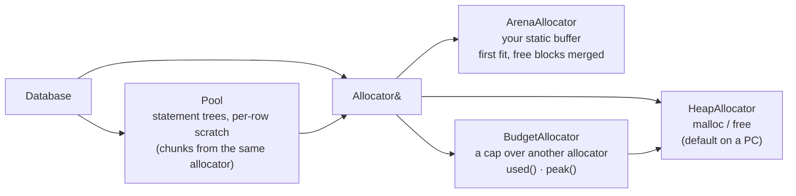

| Allocator | Use | Members |
|---|---|---|
| `HeapAllocator` (`vdb::heap_allocator()`) | PC default (absent with `VDB_NO_HEAP`) | — |
| `ArenaAllocator(buffer, size)` | MCUs, hard caps: serves a buffer you own | `capacity()`, `used()`, `peak()` |
| `BudgetAllocator(parent, limit)` | a cap: refuses beyond `limit` (this is `--memory-limit`) | `used()`, `peak()`, `limit()`, `set_limit(n)` |
| your own | derive from `vdb::Allocator`: `allocate(size)` returns 0 when it cannot serve; `release(block)` | — |

`examples/pc/08_mcu_arena.cpp` runs the database in 64 KB and fills it on purpose:

```cpp
static unsigned char memory[64 * 1024];  // all the database may use

int main() {
    vdb::ArenaAllocator arena(memory, sizeof(memory));
    vdb::Database db(arena);
    db.exec("CREATE TABLE readings (sensor, celsius)");
    for (int i = 0; i < 40; ++i) {
        db.insert("readings").value("sensor", i % 2 ? "out" : "in").value("celsius", 18.0 + i * 0.25).run();
    }
    // ... a GROUP BY report, then inserts until the arena is full, then:
    db.exec("DELETE FROM readings WHERE sensor = 'spare'");
}
```

```
in: 20 readings, avg 22.75 C, max 27.5 C
out: 20 readings, avg 23 C, max 27.75 C
arena: 2200 of 65536 bytes in use, peak 15496
after 1599 more rows: out of memory
still works: 40 readings
```

Exact rules (spec A5, §4.3):

- Every allocation failure becomes the error `out of memory` of the statement. A statement that fails halfway keeps the
  records written before it and drops its own temporaries.
- `malloc` appears only in `HeapAllocator`; with `-DVDB_NO_HEAP` it is compiled out (and so are `Database()`,
  `Params()` without an allocator).
- A statement needs working memory of its own (parse tree, per-row scratch: `VDB_POOL_CHUNK`, `VDB_SCRATCH_CHUNK`), so
  leave headroom in an arena beyond the records you keep.

### 5.10 Options

| `db.options().` | Meaning | Default |
|---|---|---|
| `decimal_separator` | `'.'` or `','`: how text reads as a number and how computed reals are written (spec A19) | `'.'` |
| `streaming` | stream a CSV table read once (spec A7) | `true` |
| `table_resolver`, `resolver_user` | called with a table name the database does not know; may add the table (spec A10). `sel` and `vdb` open CSV files with it. | none |

```cpp
vdb::Database br;
br.options().decimal_separator = ',';
br.load_csv_text("precos", "produto;preco\nAntena;120,50\nCabo;12,00\n", vdb::CsvOptions());
vdb::Result t = br.query("SELECT SUM(preco) AS total, AVG(preco) AS media FROM precos WHERE preco > 10");
// t[0]["total"].text() = "132,5", t[0]["media"].text() = "66,25", t[0]["total"].number() = 132.5
```

A resolver that knows one table:

```cpp
vdb::Table* open_known(vdb::Database& db, const char* name, void* user, vdb::Status& status) {
    (void)user;
    if (strcmp(name, "bands") != 0) return 0;  // not mine: the query says "no such table"
    status = db.load_csv_text("bands", "band;mhz\n20m;14\n40m;7\n", vdb::CsvOptions());
    return status.ok() ? db.table("bands") : 0;
}

vdb::Database db;
db.options().table_resolver = open_known;
db.query("SELECT band FROM bands WHERE mhz > 10");  // 20m
db.query("SELECT * FROM nothing").error();          // no such table: nothing
```

### 5.11 Tables

`db.table(name)` (0 if absent), `db.table_count()`, `db.table_at(i)`, `db.create_table(name, status)`,
`db.drop_table(name)`; a `Table` has `name()`, `column_count()`, `column_name(i)`, `row_count()`. Names are
case-insensitive (spec A8). A `Database` is not copyable and is used by one thread at a time.

### 5.12 The PC examples

All in [`examples/pc/`](examples/pc); `make examples` builds them into `bin/examples/`, `make examples_run` runs each
one in `examples/data`.

| Example | Shows |
|---|---|
| `01_first_query` | create, insert, query, read cells |
| `02_word_chain` | the word chain, `sql()`, escaping, `open()`/`close()`, `in()`, update and delete |
| `03_flexible_values` | numbers vs text in comparisons, NULL, ordering, SUM over text |
| `04_pipelines` | `|>`, `_`, clause-only stages, `then()`, `CREATE TABLE ... AS` |
| `05_joins_and_groups` | inner/left/full joins, GROUP BY with HAVING, UNION, WITH; table output |
| `06_csv_in_memory` | CSV from strings, a regex delimiter, every output format |
| `07_streaming_sink` | a `ByteSource` that generates rows, a `RowSink` that stops early |
| `08_mcu_arena` | a 64 KB `ArenaAllocator`, filling it, recovering |
| `09_params_safe` | `?` and `?N` with `Params` |

---

## 6. Flexible values in depth

### 6.1 Four kinds of value

**In plain words.** Inside an expression a value is one of four kinds. Where it comes from decides its kind, and its
kind decides how comparisons treat it.

| Kind | Comes from | Example |
|---|---|---|
| NULL | `NULL`, a missing field, an unquoted empty CSV field, a failed math step | `NULL` |
| number (integer or real) | a bare numeric literal; `+ - * / %`; numeric functions; aggregates | `30`, `2.5`, `1e3` |
| strict text | a quoted literal; `CAST(x AS TEXT)` | `'30'`, `'Rio'` |
| flexible text | a field; a text function's result; a parameter given as text | the field `age` holding `017` |

A text **reads as a number** when, after optional ASCII spaces, it is: an optional sign, digits with an optional
decimal separator and digits (at least one digit in all), an optional exponent (`e`/`E`, optional sign, digits), then
optional spaces. The separator is `.` or, with `--decimal-comma`, `,`. Integers that fit 64 bits are integers; others
are reals. `inf`, `nan`, hex and thousands separators are not numbers.

### 6.2 How a comparison decides

For `= == <> != < <= > >=`, `BETWEEN`, `IN`, `IS DISTINCT FROM` and `CASE x WHEN`:

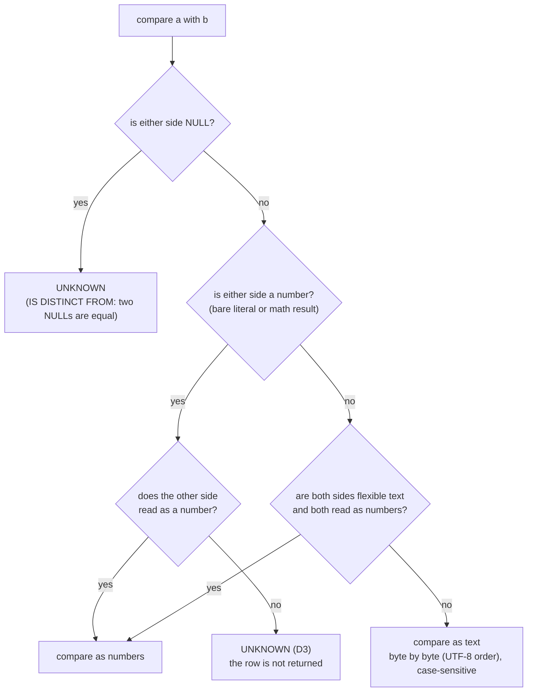

1. If either side is NULL the result is UNKNOWN (except `IS [NOT] DISTINCT FROM`, which treats two NULLs as equal).
2. If either side is a **number**, the other side must read as a number: numbers are compared; if it does not read as a
   number, the result is **UNKNOWN** (decision D3).
3. If both sides are **flexible** text and both read as numbers, numbers are compared.
4. Otherwise both are compared as text: byte by byte (UTF-8 code point order), case-sensitive.

**Why UNKNOWN and not "false"?** UNKNOWN is SQL's own third truth value. A row is returned only when WHERE is true, and
`NOT UNKNOWN` is still UNKNOWN — so `WHERE age > 10` and `WHERE NOT (age > 10)` both skip `N/A`. A math clause matches
only numbers, and never silently by text. Use `IS_NUMBER(x)` to find the rows that are not numbers.

### 6.3 The truth table, measured

Bruno's age is `N/A`, Carla's is `017`. UNKNOWN prints as NULL; `--null UNKNOWN` makes it visible:

```sh
sel "name, age, age = 17 as num_eq, age > 10 as gt10, not (age > 10) as not_gt10, age = '017' as text_eq, age = '17' as text_eq17, age like '%1%' as like1, typeof(age) as t, is_number(age) as isnum" from people.csv where "name in ('Carla', 'Bruno')" -o table --null UNKNOWN
```

```
+-------+-----+---------+---------+----------+---------+-----------+-------+------+-------+
| name  | age | num_eq  | gt10    | not_gt10 | text_eq | text_eq17 | like1 | t    | isnum |
+-------+-----+---------+---------+----------+---------+-----------+-------+------+-------+
| Bruno | N/A | UNKNOWN | UNKNOWN | UNKNOWN  |       0 |         0 |     0 | text |     0 |
| Carla | 017 |       1 |       1 |        0 |       1 |         0 |     1 | text |     1 |
+-------+-----+---------+---------+----------+---------+-----------+-------+------+-------+
(2 rows)
```

| Expression | `age` = `'017'` | `age` = `'N/A'` |
|---|---|---|
| `age = 17` | true (numbers) | UNKNOWN (D3) |
| `age > 10` | true | UNKNOWN |
| `NOT (age > 10)` | false | UNKNOWN |
| `age = '017'` | true (text) | false |
| `age = '17'` | false (text: `017` ≠ `17`) | false |
| `age LIKE '%1%'` | true (text) | false |

Mixing both kinds of test in one WHERE:

```
$ sel "name, phone from people.csv where phone like '%5550%' and age > 25" -o table
+--------------+------------------+
| name         | phone            |
+--------------+------------------+
| Ana          | +55 21 5550-1234 |
| Gil "Junior" | +55 31 5550-2222 |
+--------------+------------------+
(2 rows)
```

`examples/pc/03_flexible_values.cpp` runs the same ideas over five codes:

```
codes: a='017' b='17' c='N/A' d='170' e=NULL

code = 17          (a number: math)          -> a b
code = '017'       (quoted: text)            -> a
code > 20          (N/A never matches math)  -> d
NOT (code > 20)    (nor its NOT)             -> a b
code LIKE '%17%'   (digits as text)          -> a b d
code IS NULL                                 -> e
IS_NUMBER(code) = 0                          -> c e
ORDER BY code      (NULL, numbers, text)     -> e a b d c
SUM(code)          (N/A is skipped)          -> 204
code * 2                                     -> 34 34  340 
```

### 6.4 Math

Math (`+ - * / %`, unary `-`, numeric functions) reads each operand as a number; an operand that does not read gives
NULL. Integer math overflows into a real. `/` of two integers is integer division when exact, real otherwise. Division
or modulo by zero gives NULL (spec A16). `||` and text functions read numbers as their formatted text.

```
$ vdb -c "SELECT 1 + 1 AS two, 7 / 2 AS half, 6 / 2 AS exact, 1 / 0 AS div0, 9223372036854775807 + 1 AS big"
+-----+------+-------+------+----------------------+
| two | half | exact | div0 | big                  |
+-----+------+-------+------+----------------------+
|   2 |  3.5 |     3 |      | 9.22337203685478e+18 |
+-----+------+-------+------+----------------------+
(1 row)
```

### 6.5 Order, grouping and DISTINCT

One total order: **NULL < numbers < text**. A text that reads as a number sorts and groups as that number (`'10'`,
`10.0`, ` 10` are one group; `'09'` sorts before `'10'`). Text sorts by bytes. NULLs are equal to each other here
(`GROUP BY` and `DISTINCT` keep one NULL group). `ORDER BY ... NULLS FIRST | LAST` overrides the place of NULL (default:
first for ASC, last for DESC). Sorting is stable. MIN and MAX use the same order.

```
$ sel name, age from people.csv order by age -o table
+--------------+-----+
| name         | age |
+--------------+-----+
| Carla        | 017 |
| Eva          |  22 |
| Gil "Junior" |  29 |
| Ana          |  31 |
| Fábio        |  38 |
| Davi         |  45 |
| Bruno        | N/A |
+--------------+-----+
(7 rows)
```

Aggregates skip what is not a number, `COUNT(x)` counts values, and MIN/MAX follow the order above:

```
$ sel "sum(age) as total, avg(age) as average, count(age) as with_age, count(*) as all_rows, min(age) as lo, max(age) as hi" from people.csv -o table
+-------+------------------+----------+----------+-----+-----+
| total | average          | with_age | all_rows | lo  | hi  |
+-------+------------------+----------+----------+-----+-----+
|   182 | 30.3333333333333 |        7 |        7 | 017 | N/A |
+-------+------------------+----------+----------+-----+-----+
(1 row)
```

### 6.6 How numbers are written

Integers print exactly. Reals print with up to 15 significant digits (6 on AVR, where `double` is 32-bit), without
trailing zeros, in plain notation from 1e-5 to 1e15 and in exponent notation (`1.5e+20`) outside, with the decimal
separator of the options. Booleans are integers: true is 1, false is 0. Stored text is never reformatted: `017` and
`120.50` print as they were read.

---

## 7. SQL reference

**In plain words.** vDB speaks the SQL most people know (SQLite, PostgreSQL, MySQL style), plus pipelines. This section
lists every statement, operator and function. `sel --help-sql` is the one-screen version; `sel --functions` lists
every function.

### 7.1 Lexical rules

- Keywords and names are case-insensitive. Names: letters, digits, `_` (not starting with a digit), or quoted with
  `"..."`, `` `...` `` or `[...]` (a doubled quote inside stands for one). Reserved words used as names must be quoted
  (`"order"`).
- Strings: `'...'` with `''` for a quote. Numbers: `12`, `1.5`, `.5`, `1e-3`.
- Parameters: `?` (next), `?N` (N-th, from 1).
- Comments: `-- to end of line`, `/* ... */`. Statements are separated by `;`.

### 7.2 Statements

```
script      := statement { ";" statement } [";"]
statement   := query | insert | update | delete | create | drop
query       := [ WITH name AS "(" query ")" { "," name AS "(" query ")" } ] compound { "|>" stage }
compound    := select_core { (UNION [ALL] | INTERSECT | EXCEPT) select_core } [order_by] [limit]
select_core := SELECT [DISTINCT | ALL] items [FROM from] [WHERE expr] [GROUP BY exprs] [HAVING expr]
stage       := [SELECT [DISTINCT] items] [FROM from] [WHERE expr] [GROUP BY exprs] [HAVING expr] [order_by] [limit]
               (at least one clause)
items       := item { "," item }          item := "*" | name ".*" | expr [[AS] alias]
from        := source { ("," source) | join }
source      := table_name [[AS] alias] | "(" query ")" [AS] alias
join        := [INNER | LEFT [OUTER] | RIGHT [OUTER] | FULL [OUTER] | CROSS] JOIN source [ON expr | USING "(" names ")"]
order_by    := ORDER BY expr [ASC | DESC] [NULLS (FIRST | LAST)] { "," ... }
limit       := LIMIT expr [OFFSET expr] | LIMIT expr "," expr | OFFSET expr [ROWS] | FETCH (FIRST|NEXT) expr ROWS ONLY
insert      := INSERT INTO name ["(" names ")"] (VALUES "(" exprs ")" { "," "(" exprs ")" } | query)
update      := UPDATE name SET name "=" expr { "," name "=" expr } [WHERE expr]
delete      := DELETE FROM name [WHERE expr]
create      := CREATE TABLE [IF NOT EXISTS] name ( "(" column_def { "," column_def } ")" | AS query )
column_def  := name [type_name ["(" number ["," number] ")"]]     (the type is accepted and ignored)
drop        := DROP TABLE [IF EXISTS] name
```

- `LIMIT a, b` is MySQL's form (skip a, take b). `USING (a, b)` means `ON l.a = r.a AND l.b = r.b`.
- ORDER BY may name a select alias, an output position (`ORDER BY 2`) or any expression over the sources. GROUP BY may
  name a select alias or position too. HAVING and ORDER BY may use aggregates.
- A SELECT without FROM reads `_` when a table `_` is in scope (the previous stage, or the default input of
  `sel`/`vdb`); otherwise it produces one row (`SELECT 1 + 1`).
- `INSERT INTO t SELECT ...` without a column list **maps by name** (missing columns are created); with a column list,
  by position. `INSERT ... VALUES` without a list is positional over the table's columns (spec A11).
- Records are not rows of a fixed schema: column types in CREATE TABLE are accepted and ignored.
- DML results: `Result::changes()` counts the records inserted, updated or deleted; CREATE and DROP return no rows.

The LIMIT forms, over `people.csv` ordered by name (Ana, Bruno, Carla, Davi, Eva, Fábio, Gil):

| Query tail | Rows |
|---|---|
| `ORDER BY name LIMIT 2 OFFSET 1` | Bruno, Carla |
| `ORDER BY name LIMIT 1, 2` | Bruno, Carla |
| `ORDER BY name OFFSET 5 ROWS` | Fábio, Gil "Junior" |
| `ORDER BY name FETCH FIRST 2 ROWS ONLY` | Ana, Bruno |
| `ORDER BY email NULLS FIRST LIMIT 2` (name, email) | Bruno (NULL), Ana |

### 7.3 Operators, from lowest to highest precedence

| Level | Operators |
|---|---|
| 1 | `OR` |
| 2 | `AND` |
| 3 | `NOT` (prefix) |
| 4 | `= == != <> < <= > >=`, `IS [NOT] NULL`, `IS [NOT] TRUE/FALSE`, `IS [NOT] DISTINCT FROM`, `[NOT] BETWEEN a AND b`, `[NOT] IN (list / query / table)`, `[NOT] LIKE p [ESCAPE c]`, `[NOT] ILIKE`, `[NOT] GLOB`, `[NOT] REGEXP`, `[NOT] RLIKE`, `[NOT] SIMILAR TO`, `~ ~* !~ !~*` |
| 5 | `\|\|` (concatenation) |
| 6 | `+ -` |
| 7 | `* / %` |
| 8 | unary `- +` |
| 9 | literals, parameters, names, `name.name`, calls, `( expr )`, `( query )`, `CASE`, `CAST`, `EXISTS ( query )` |

### 7.4 Text matching

| Form | Matches | Case |
|---|---|---|
| `x LIKE 'A%'` | `%` any run, `_` one character; `ESCAPE '\'` makes the next character literal | sensitive |
| `x ILIKE 'a%'` | as LIKE | insensitive (ASCII and Latin-1 letters in UTF-8) |
| `x GLOB '*.csv'` | `*` any run, `?` one, `[a-z]` / `[^0-9]` classes | sensitive |
| `x SIMILAR TO '(A\|B)%'` | the whole text, SQL:1999: `%` `_` plus regex `\| * + ? {m,n} ( ) [ ]` | sensitive |
| `x REGEXP 'pat'`, `x RLIKE 'pat'`, `x ~ 'pat'` | a regex match anywhere (anchor with `^ $`) | sensitive |
| `x ~* 'pat'` | as `~` | insensitive |
| `x !~ 'pat'`, `x !~* 'pat'` | not | — |
| `CONTAINS(x, s)`, `STARTS_WITH(x, s)`, `ENDS_WITH(x, s)` | plain substring | sensitive |

```
$ vdb -o jsonl -c "SELECT CASE WHEN 5 > 3 THEN 'big' ELSE 'small' END AS a, CASE 'b' WHEN 'a' THEN 1 WHEN 'b' THEN 2 END AS b, 'abc' LIKE 'A%' AS c, 'abc' ILIKE 'A%' AS d, 'data.csv' GLOB '*.csv' AS e, 'Bob' SIMILAR TO '(Ana|Bob)%' AS f, 'PY2ABC' ~ '^PY[0-9]' AS g, 'py2abc' ~* '^PY' AS h, 3 BETWEEN 1 AND 5 AS i, NULL IS DISTINCT FROM NULL AS j, 5 IN (1, 5) AS k"
{"a":"big","b":2,"c":0,"d":1,"e":1,"f":1,"g":1,"h":1,"i":1,"j":0,"k":1}
```

### 7.5 Regular expressions

**In plain words.** vDB's regular expressions run on a Pike VM: every alternative advances in step, so time grows with
text length times pattern length, never exponentially. A pattern like `(a+)+$` cannot hang the program.

- Syntax: literals; `.` (any character but newline; any with flag `s`); `[...]`, `[^...]` with ranges, escapes and the
  POSIX classes `[:alpha:] [:digit:] [:alnum:] [:space:] [:upper:] [:lower:] [:punct:] [:xdigit:]`; `\d \D \w \W \s
  \S`; `\b \B`; `^ $` (line ends too with flag `m`); groups `( )` and `(?: )`; `|`; `* + ? {n} {n,} {n,m}` and their
  lazy forms with a trailing `?`; escapes `\t \n \r \f \v \xHH \uHHHH` and `\` before any punctuation.
- Matching is by UTF-8 code points, leftmost-first (Perl order).
- Flags (a text argument): `i` case-insensitive, `m` multi-line, `s` dot-all, `1` first match only (REGEXP_REPLACE).
- In a replacement, `\N` or `$N` (N = 0..9) inserts group N, `\\` a backslash, `$$` a dollar.
- Not supported: back-references (`regex: back-references are not supported`), look-around and named groups
  (`regex: only (?: ) groups are supported`).

```
$ vdb -o jsonl -c "SELECT REGEXP_SUBSTR('PY2ABC', '^([A-Z]+)(\d)', 1) AS prefix, REGEXP_REPLACE('a1b22c333', '\d+', '#') AS all_, REGEXP_REPLACE('a1b22c333', '\d+', '#', '1') AS first, REGEXP_COUNT('a1b22c333', '\d+') AS n, REGEXP_INSTR('abc123', '\d') AS pos, REGEXP_LIKE('Hello', '^h', 'i') AS ci, REGEXP_REPLACE('Gustavo Campos', '(\w+) (\w+)', '\2, \1') AS swapped"
{"prefix":"PY","all_":"a#b#c#","first":"a#b22c333","n":3,"pos":4,"ci":1,"swapped":"Campos, Gustavo"}
```

`REGEXP_REPLACE` replaces **every** match by default (as MySQL, Oracle, BigQuery, Snowflake); flag `'1'` replaces only
the first (spec A13).

### 7.6 Scalar functions

| Group | Functions |
|---|---|
| null and choice | `COALESCE(a, ...)`, `IFNULL(a, b)`, `NVL(a, b)`, `NULLIF(a, b)`, `IIF(c, a, b)`, `GREATEST(a, ...)`, `LEAST(a, ...)` |
| types | `TYPEOF(x)` → `null` / `integer` / `real` / `text`, `IS_NUMBER(x)` / `ISNUMERIC(x)` → 1/0, `CAST(x AS INTEGER/INT/BIGINT/REAL/FLOAT/DOUBLE/NUMERIC/DECIMAL/TEXT/VARCHAR/CHAR)` |
| text | `LENGTH` / `LEN` / `CHAR_LENGTH` / `CHARACTER_LENGTH`, `OCTET_LENGTH`, `UPPER` / `UCASE`, `LOWER` / `LCASE`, `TRIM(x [, chars])`, `LTRIM`, `RTRIM`, `SUBSTR` / `SUBSTRING(x, start [, len])`, `LEFT(x, n)`, `RIGHT(x, n)`, `REPLACE(x, from, to)`, `INSTR(x, s)`, `POSITION(s IN x)`, `LPAD(x, n [, fill])`, `RPAD`, `REVERSE`, `REPEAT(x, n)`, `CONCAT(a, ...)` (skips NULL), `CONCAT_WS(sep, a, ...)`, `SPLIT_PART(x, sep, n)`, `INITCAP`, `ASCII`, `CHAR` / `CHR(n, ...)`, `CONTAINS`, `STARTS_WITH`, `ENDS_WITH`, `PRINTF` / `FORMAT(fmt, ...)` (`%s %d %i %f %.Nf %x %%`) |
| regex | `REGEXP_LIKE(x, p [, flags])`, `REGEXP_SUBSTR(x, p [, group [, flags]])` (alias `REGEXP_EXTRACT`), `REGEXP_REPLACE(x, p, r [, flags])`, `REGEXP_COUNT(x, p [, flags])`, `REGEXP_INSTR(x, p [, flags])` |
| math | `ABS`, `SIGN`, `ROUND(x [, d])`, `TRUNC` / `TRUNCATE(x [, d])`, `FLOOR`, `CEIL` / `CEILING`, `MOD(a, b)`, `POWER` / `POW`, `SQRT`, `EXP`, `LN`, `LOG(x)` / `LOG(b, x)`, `LOG10`, `LOG2`, `PI()`, `SIN`, `COS`, `TAN`, `ASIN`, `ACOS`, `ATAN`, `ATAN2`, `DEGREES`, `RADIANS` |

Positions are 1-based and count UTF-8 characters. A function given NULL returns NULL, except the null-and-choice group,
`CONCAT`, `CONCAT_WS`, `TYPEOF` and `IS_NUMBER`. A math function whose argument does not read as a number returns NULL;
a domain error (`SQRT(-1)`, `LN(0)`) returns NULL. `||` with a NULL gives NULL; `CONCAT` skips it.

```
$ vdb -o jsonl -c "SELECT UPPER('ação') AS up, LENGTH('ação') AS chars, OCTET_LENGTH('ação') AS bytes, INITCAP('são paulo') AS cap, SUBSTR('PY2ABC', 3, 1) AS region, LPAD('7', 3, '0') AS padded"
{"up":"AÇÃO","chars":4,"bytes":6,"cap":"São Paulo","region":2,"padded":"007"}

$ vdb -o jsonl -c "SELECT SPLIT_PART('14.074;FT8', ';', 2) AS mode, CONCAT('a', NULL, 'b') AS c, CONCAT_WS('-', 'a', NULL, 'b') AS cw, 'x' || NULL AS pipe_null, REPLACE('a.b.c', '.', '/') AS r, REVERSE('vDB') AS rev, PRINTF('%s has %d QSOs, %.2f MHz', 'PY2ABC', 3, 14.2) AS p"
{"mode":"FT8","c":"ab","cw":"a-b","pipe_null":null,"r":"a/b/c","rev":"BDv","p":"PY2ABC has 3 QSOs, 14.20 MHz"}

$ vdb -o jsonl -c "SELECT ROUND(3.14159, 2) AS r, TRUNC(-2.7) AS t, FLOOR(-2.5) AS f, CEIL(2.1) AS c, MOD(17, 5) AS m, POWER(2, 10) AS p, SQRT(-1) AS bad, LOG(2, 1024) AS lg, ROUND(PI(), 5) AS pi, ABS('-3') AS a"
{"r":3.14,"t":-2,"f":-3,"c":3,"m":2,"p":1024,"bad":null,"lg":10,"pi":3.14159,"a":3}

$ vdb -o jsonl -c "SELECT TYPEOF(NULL) AS a, TYPEOF(1) AS b, TYPEOF(1.5) AS c, TYPEOF('x') AS d, CAST('017' AS INTEGER) AS e, CAST(17 AS TEXT) = '17' AS f, COALESCE(NULL, NULL, 'third') AS g, NULLIF(5, 5) AS h, IIF(2 > 1, 'yes', 'no') AS i, GREATEST(3, 9, 4) AS j, IS_NUMBER(' 42 ') AS k, IS_NUMBER('1,5') AS l"
{"a":"null","b":"integer","c":"real","d":"text","e":17,"f":1,"g":"third","h":null,"i":"yes","j":9,"k":1,"l":0}
```

(These run on a terminal: in a script, give `vdb` a FROM or a terminal stdin — see the rule at the end of §3.9.)

`sel --functions` (`*` = aggregate; `(n)` = number of arguments):

```
Functions (* = aggregate; (n) = arguments):
COALESCE(1+)              IFNULL(2)                 NVL(2)                    
NULLIF(2)                 IIF(3)                    GREATEST(1+)              
LEAST(1+)                 TYPEOF(1)                 IS_NUMBER(1)              
ISNUMERIC(1)              LENGTH(1)                 LEN(1)                    
CHAR_LENGTH(1)            CHARACTER_LENGTH(1)       OCTET_LENGTH(1)           
UPPER(1)                  UCASE(1)                  LOWER(1)                  
LCASE(1)                  TRIM(1-2)                 LTRIM(1-2)                
RTRIM(1-2)                SUBSTR(2-3)               SUBSTRING(2-3)            
LEFT(2)                   RIGHT(2)                  REPLACE(3)                
INSTR(2)                  LPAD(2-3)                 RPAD(2-3)                 
REVERSE(1)                REPEAT(2)                 CONCAT(1+)                
CONCAT_WS(2+)             SPLIT_PART(3)             INITCAP(1)                
ASCII(1)                  CHAR(1+)                  CHR(1+)                   
CONTAINS(2)               STARTS_WITH(2)            ENDS_WITH(2)              
PRINTF(1+)                FORMAT(1+)                REGEXP_LIKE(2-3)          
REGEXP_SUBSTR(2-4)        REGEXP_EXTRACT(2-4)       REGEXP_REPLACE(3-4)       
REGEXP_COUNT(2-3)         REGEXP_INSTR(2-3)         ABS(1)                    
SIGN(1)                   ROUND(1-2)                TRUNC(1-2)                
TRUNCATE(1-2)             FLOOR(1)                  CEIL(1)                   
CEILING(1)                MOD(2)                    POWER(2)                  
POW(2)                    SQRT(1)                   EXP(1)                    
LN(1)                     LOG(1-2)                  LOG10(1)                  
LOG2(1)                   PI(0)                     SIN(1)                    
COS(1)                    TAN(1)                    ASIN(1)                   
ACOS(1)                   ATAN(1)                   ATAN2(2)                  
DEGREES(1)                RADIANS(1)                COUNT(0-1)*               
SUM(1)*                   TOTAL(1)*                 AVG(1)*                   
MIN(1+)*                  MAX(1+)*                  GROUP_CONCAT(1-2)*        
STRING_AGG(2)*            STDDEV(1)*                STDDEV_SAMP(1)*           
STDDEV_POP(1)*            VARIANCE(1)*              VAR_SAMP(1)*              
VAR_POP(1)*               MEDIAN(1)*                
```

### 7.7 Aggregates

`COUNT(*)`, `COUNT(x)`, `COUNT(DISTINCT x)`, `SUM`, `TOTAL` (0 instead of NULL), `AVG`, `MIN`, `MAX`,
`GROUP_CONCAT(x [, sep])` / `STRING_AGG(x, sep)` (default separator `,`), `STDDEV` / `STDDEV_SAMP`, `STDDEV_POP`,
`VARIANCE` / `VAR_SAMP`, `VAR_POP`, `MEDIAN`.

- Every aggregate but `COUNT(*)` skips NULL; the numeric ones skip values that do not read as numbers (D3).
- `DISTINCT` is accepted in every aggregate.
- An aggregate query without GROUP BY returns exactly one row.
- MIN and MAX use the order of §6.5.
- A column used in an aggregate query without being grouped takes its value from the **first row of the group**
  (spec A15), so `SELECT city, name, COUNT(*) ... GROUP BY city` runs.

```
$ sel "band, count(*) as qsos, count(distinct call) as calls, string_agg(call, ' ') as who, round(avg(freq_mhz), 3) as avg_mhz, median(freq_mhz) as med" from qso_log.csv -d comma group by band order by qsos desc -o table
+------+------+-------+-----------------------------+---------+---------+
| band | qsos | calls | who                         | avg_mhz | med     |
+------+------+-------+-----------------------------+---------+---------+
| 20m  |    4 |     4 | PY2ABC LU1XYZ EA4DEF VK2GHI |  14.151 | 14.1395 |
| 40m  |    2 |     2 | W1AW PY2ABC                 |    7.09 |    7.09 |
| 15m  |    1 |     1 | JA1QRZ                      |  21.074 |  21.074 |
+------+------+-------+-----------------------------+---------+---------+
(3 rows)
```

Over zero rows, one row comes back: `COUNT` is 0, `TOTAL` is 0, the others are NULL:

```
$ sel "count(*) as n, sum(price) as s, total(price) as t, round(stddev(price), 2) as sd, round(variance(price), 1) as var, median(price) as med, min(product) as first, max(product) as last" from orders.csv where "price > 1000" -o table --null NULL
+---+------+---+------+------+------+-------+------+
| n | s    | t | sd   | var  | med  | first | last |
+---+------+---+------+------+------+-------+------+
| 0 | NULL | 0 | NULL | NULL | NULL | NULL  | NULL |
+---+------+---+------+------+------+-------+------+
(1 row)
```

### 7.8 Joins

**In plain words.** A join puts rows of two sources side by side when they match. The kind of join says what happens
to rows that find no partner.

| Kind | Keeps | customers ⋈ orders on `o.customer_id = c.id` (§3.8) |
|---|---|---|
| `JOIN` / `INNER JOIN` | pairs that match | 5 rows: Ana ×2, Davi, Eva ×2 |
| `LEFT JOIN` | every left row; NULLs when no match | + Zoe with NULLs |
| `RIGHT JOIN` | every right row; NULLs when no match | + order 105 (customer 9) with a NULL name |
| `FULL JOIN` | both | + Zoe and + order 105 |
| `CROSS JOIN`, or `a, b` | every pair (filter with WHERE) | 4 × 6 = 24 pairs |

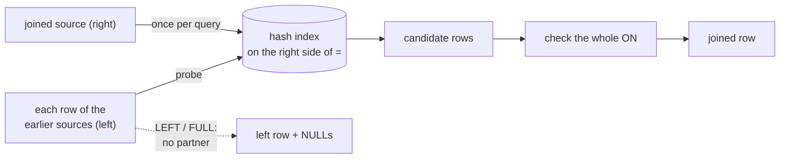

Exact rules (spec §3.8): the tree is left-deep: `a JOIN b ... JOIN c ...` joins `(a ⋈ b) ⋈ c`. When ON holds an
equality `l = r` (alone or under AND) whose one side uses only the earlier sources and the other only the joined
source, that source is indexed by a hash of `r` once per query, and each left row probes it; ON is still checked in
full. Otherwise every pair is tested. `USING (a, b)` means `ON l.a = r.a AND l.b = r.b`. `NATURAL JOIN` is not
supported.

### 7.9 Subqueries and WITH

- `(SELECT ...)` as a value: zero rows → NULL; one row → its first column; more → the error
  `a subquery used as a value returned more than one row` (spec A14).
- `x IN (SELECT ...)`, `x IN table` (also `IN _`): the first column, NULLs following SQL's rules.
- `EXISTS (SELECT ...)`.
- A subquery may name the columns of the query around it (*correlated*); it then runs once per outer row; otherwise it
  runs once per statement and its result is kept.
- `WITH a AS (...), b AS (...) query`: each named query is computed once, in order, and is visible to the later ones
  and to every stage of the query.

```
$ sel "name from customers.csv where id in (select customer_id from orders.csv where price > 100)"
name
Ana
Davi
Eva

$ sel "name from people.csv where age > (select avg(age) from people.csv)"
name
Ana
Davi
Fábio

$ sel with br as "(select id from customers.csv where country = 'BR')" select product, price from orders.csv where "customer_id in br" -o table
+------------+--------+
| product    | price  |
+------------+--------+
| antenna    | 120.50 |
| coax cable |  12.00 |
| radio      | 899.90 |
+------------+--------+
(3 rows)
```

A correlated subquery, in `vdb`:

```
$ vdb -o table -c "SELECT name, (SELECT COUNT(*) FROM orders.csv o WHERE o.customer_id = c.id) AS n FROM customers.csv c"
+------+---+
| name | n |
+------+---+
| Ana  | 2 |
| Davi | 1 |
| Eva  | 2 |
| Zoe  | 0 |
+------+---+
(4 rows)
```

### 7.10 Set operations

`UNION` (distinct), `UNION ALL`, `INTERSECT`, `EXCEPT` over the same number of columns; the names come from the first
SELECT; equality as in §6.5. A trailing ORDER BY / LIMIT applies to the whole compound.

| Query | Rows |
|---|---|
| `SELECT id FROM customers.csv INTERSECT SELECT customer_id FROM orders.csv` | 1, 2, 3 |
| `SELECT id FROM customers.csv EXCEPT SELECT customer_id FROM orders.csv` | 4 |
| `SELECT customer_id FROM orders.csv UNION ALL SELECT id FROM customers.csv ORDER BY 1 LIMIT 4` | 1, 1, 1, 2 |

### 7.11 Pipelines

**In plain words.** `|>` passes the rows of one query to the next step. A step may be a whole SELECT or just one
clause. Inside a step, `_` is the previous result, so a step can relate it to any other table.

```sql
SELECT customer_id, SUM(total) AS spent FROM orders GROUP BY customer_id
|> WHERE spent > 100
|> SELECT c.name, p.spent FROM _ AS p JOIN customers c ON c.id = p.customer_id
|> ORDER BY spent DESC
```

From `examples/pc/04_pipelines.cpp`:

```
customers with an order above 200:
  name=Davi, country=BR
  name=Eva, country=PT
top 2 orders:
  id=102, customer_id=2, total=899.9
  id=103, customer_id=3, total=241
spend per customer, above 100:
  name=Davi, spent=899.9
  name=Eva, spent=391
  name=Ana, spent=156.5
word chain:
  name=Davi
  name=Eva
vip names:
  name=Davi
  name=Eva
```

Exact rules (spec D2, §3.11):

- Stage 1 is a full query (WITH and set operations allowed). Each later stage is a `stage` of §7.2.
- Inside a stage, `_` is the previous stage's result; FROM omitted means `FROM _`; SELECT omitted means `SELECT *`.
- A stage whose only source is `_`, used once, receives the previous stage's rows as they are produced; otherwise the
  previous result is first kept as a temporary table.
- A pipeline is a query: it can follow `CREATE TABLE x AS`, `INSERT INTO x`, appear in WITH and as a subquery.
- A stage sees only the columns the stage before it selected.
- Between programs, CSV on stdin is `_`: `sel "*" from big.csv where "x > 1" | sel "count(*)"`.

### 7.12 Not supported in v1.0

Window functions (`OVER`), recursive WITH, `LATERAL`, date and time types and functions (ISO dates compare correctly as
text), indexes, constraints, transactions, views, triggers, `ALTER TABLE`, `NATURAL JOIN`, back-references in regular
expressions. When recognized, each gives a clear error:

```
error: not supported: window functions (OVER)
error: not supported: WITH RECURSIVE
error: not supported: ALTER
error: regex: back-references are not supported
```

---

## 8. Microcontrollers

**In plain words.** The core uses no C++ standard library, no exceptions, no RTTI and no `new`; only C headers
(`<stddef.h>`, `<stdint.h>`, `<string.h>`, `<stdlib.h>`, `<math.h>`). Memory comes from an arena you give it, so it
can never use more than that buffer. On AVR, keyword tables, function tables and error texts live in flash, not in the
8 KB of RAM.

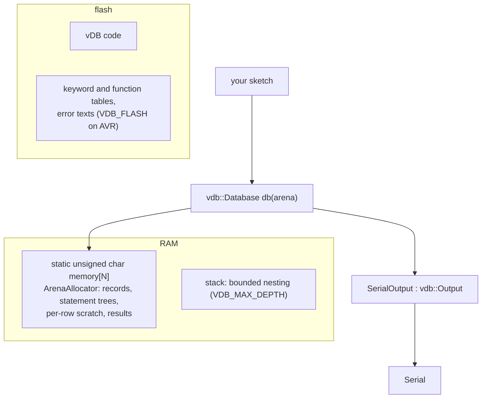

### 8.1 Targets

| Board | Status |
|---|---|
| ESP32 (`esp32:esp32:esp32`) | compiled by `make arduino_check` |
| Arduino Mega 2560 (`arduino:avr:mega`, 8 KB RAM) | compiled by `make arduino_check` |
| Arduino Uno / Nano (ATmega328P: 32 KB flash, 2 KB RAM) | too small for the SQL engine |
| PC (Linux, macOS) | built and tested |

`double` is 32-bit on AVR: reals have about 7 digits there (printed with 6 significant digits). The MCU proof is
compilation plus the PC run of the same code inside a small arena (`examples/pc/08_mcu_arena.cpp`); no sketch has run
on a board yet (§12).

### 8.2 The sketches

Both sketches put the database in a static arena, insert records with the word chain, query them with SQL and print
the result on `Serial` through an `Output`.

- [`examples/arduino/vdb_esp32/vdb_esp32.ino`](examples/arduino/vdb_esp32/vdb_esp32.ino): a 48 KB arena; a sensor
  reading every 0.5 s; every 5 s a `GROUP BY` report as a table, then `DELETE ... WHERE ms < ?` (with `Params` in the
  arena) keeps one minute of readings, so the arena never fills.
- [`examples/arduino/vdb_mega/vdb_mega.ino`](examples/arduino/vdb_mega/vdb_mega.ino): a 3 KB arena on the Mega's
  8 KB; six analog readings, one SQL `GROUP BY` and one word-chain query, printed as CSV, then the arena peak.

The shape of both:

```cpp
#include <vdb.h>

static unsigned char memory[3 * 1024];
static vdb::ArenaAllocator arena(memory, sizeof(memory));
static vdb::Database db(arena);

struct SerialOutput : vdb::Output {
    void write(const char* text, size_t length) override { Serial.write(reinterpret_cast<const uint8_t*>(text), length); }
};

void setup() {
    Serial.begin(115200);
    db.exec("CREATE TABLE pins (pin, name, value)");
    for (int pin = 0; pin < 6; ++pin) {
        db.insert("pins").value("pin", pin).value("name", pin % 2 ? "odd" : "even").value("value", analogRead(A0 + pin)).run();
    }
    SerialOutput out;
    vdb::FormatOptions csv;  // ';' separated, with a header line
    db.query("SELECT name, COUNT(*) n, MAX(value) top FROM pins GROUP BY name").write(out, csv);
}

void loop() {}
```

### 8.3 Checks

| Command | What it proves |
|---|---|
| `make check_embedded` | every core file compiles with `-fno-exceptions -fno-rtti -nostdinc++ -DVDB_NO_HEAP -Werror`, and the objects reference no C++ runtime symbol (no `operator new/delete`, `__cxa_throw`, `__gxx_personality`, typeinfo, `std::`, `__cxa_guard`) and no `malloc`/`free`; then, when the cross compilers are installed, the core compiles for AVR (atmega2560), Xtensa (ESP32) and ARM Cortex-M4 |
| `make arduino_check` | `arduino-cli` compiles both sketches warning-free against this library and reports flash and RAM use (logs in `build/arduino/*.log`) |

### 8.4 Configuration macros (`src/vdb/config.hpp`)

Define them before including vDB (or with `-D`) to change a limit. On AVR (`VDB_SMALL`) the defaults are smaller.

| Macro | Meaning | PC | AVR |
|---|---|---|---|
| `VDB_NO_HEAP` | no `HeapAllocator`, no default `Database()` / `Params()`: every allocator is yours | off | off |
| `VDB_POOL_CHUNK` | bump-pool chunk for statement trees and temporaries (bytes) | 4096 | 256 |
| `VDB_SCRATCH_CHUNK` | per-row scratch chunk (computed text of one row) | 4096 | 128 |
| `VDB_CSV_CHUNK` | CSV reader input buffer | 65536 | 64 |
| `VDB_MAX_DEPTH` | nesting bound for the parser, expressions and subqueries | 200 | 24 |
| `VDB_REGEX_MAX_PROGRAM` | largest compiled regular expression, in instructions | 8192 | 128 |
| `VDB_ERROR_SIZE` | room for one error message (reporting never allocates) | 256 | 72 |
| `VDB_FLASH`, `VDB_F(text)` | put tables and messages in flash (`PROGMEM`, `PSTR`) | empty | AVR |
| `VDB_VERSION` | `"1.0.0"` | | |

---

## 9. Safety

**In plain words.** vDB is meant to be embedded in programs that must not crash, and to take user data without being
tricked by it.

| Rule | What it means for you |
|---|---|
| No function throws, aborts or prints | every failure is a `Status` or a `Result` with a message: syntax errors with `line:column` and the token, name errors with a hint, runtime errors (`out of memory`, `a subquery used as a value returned more than one row`, `regex: ...`, `csv line N: ...`) |
| Running out of memory is an error | the statement fails, earlier records stay, the statement's temporaries are freed |
| Nesting is bounded (`VDB_MAX_DEPTH`) | deep parentheses or subqueries give `query nested too deeply (limit 200)`, never a stack overflow |
| Regular expressions are linear-time | a pattern like `(a+)+$` cannot hang the program; LIKE and GLOB match without exponential backtracking |
| A script is parsed completely before it runs | a syntax error in the third statement means the first two never ran |
| User values never become SQL | use `Params` (`?`, `?N`) or the word chain, which escapes every value; never paste user text into SQL, `expr()`, `raw()`, `select(cols)`, `group_by()`, `order_by()` |
| Out-of-range access is harmless | `r[99]["nope"]` on any `Result` (even a failed one) is a NULL cell: `text()` is `""` |
| Division by zero | NULL, not a crash or an error |

Parse-before-run, shown — the script fails on its third statement, and the first two never ran:

```
$ printf 'CREATE TABLE t (a); INSERT INTO t VALUES (1); SELEC 2;\n.tables\nSELECT COUNT(*) AS n FROM t;\n' | vdb
error: syntax error at line 1, column 47 near "SELEC": expected a statement (SELECT, INSERT, UPDATE, DELETE, CREATE, DROP)
error: no such table: t
```

Nesting:

```
$ deep=$(perl -e 'print "(" x 5000, "1", ")" x 5000')
$ vdb -c "SELECT $deep AS x"
error: query nested too deeply (limit 200)
```

---

## 10. Building and testing

**In plain words.** `make` builds everything with warnings as errors. `make test` runs the unit tests; the other
targets prove the programs, memory safety and the embedded rules.

| Target | What it does |
|---|---|
| `make` / `make all` | `lib`, `tools` and `examples` |
| `make lib` | `build/libvdb.a` |
| `make tools` | `bin/sel` and `bin/vdb` |
| `make test` | the unit tests (`bin/vdb_tests`; `make test FILTER=...` runs a subset), including fault injection: every allocation of a set of statements fails in turn — no crash, no leak, an `out of memory` error |
| `make test_small` | the unit tests again, built with the microcontroller sizes (small pool, scratch and CSV chunks, AVR nesting bound) |
| `make test_tools` | golden outputs of `sel` and `vdb` (`tests/tools/`) |
| `make sanitize` | the unit tests again under AddressSanitizer and UndefinedBehaviorSanitizer |
| `make check_embedded` | §8.3 |
| `make arduino_check` | §8.3 (needs `arduino-cli` with the `esp32:esp32` and `arduino:avr` cores) |
| `make examples` | the PC examples into `bin/examples/` |
| `make examples_run` | build and run every PC example in `examples/data` |
| `make install` | `sel` and `vdb` into `$(PREFIX)/bin` (default `/usr/local`; `DESTDIR` supported); `make uninstall` removes them |
| `make clean` | removes `build/` and `bin/` |

Flags: `-std=c++11 -Wall -Wextra -Wpedantic -Werror`, `-O2` by default (`CXXFLAGS` overrides), `CXX` selects the
compiler. Run on macOS (clang 21); GitHub Actions runs every target on Linux (g++) and macOS (clang) on each push.

### 10.1 Measured results

**In plain words.** Every gate below was run on the release build (2026-10-29, Apple M-series, macOS, clang 21).

| Gate | Command | Result |
|---|---|---|
| unit tests | `make test` | 93 of 93 |
| unit tests, microcontroller sizes | `make test_small` | 93 of 93 |
| program tests | `make test_tools` | 31 of 31 golden outputs (options, formats, joins of files, stdin, shell pipes, hints, exit codes, memory limits) |
| sanitizers | `make sanitize` | 93 of 93 under AddressSanitizer + UndefinedBehaviorSanitizer, no report |
| fault injection | `make test` | every allocation of a 9-statement script (joins, groups, pipelines, regex, subqueries, DML) failed in turn: each run an `out of memory` error, 0 blocks leaked |
| random input | `make test` | 3,000 random SQL token soups and 2,000 random CSV byte strings: no crash |
| examples | `make examples_run` | 9 of 9 |
| embedded | `make check_embedded` | no C++ runtime, exception, RTTI or heap symbol; avr-gcc 7.3 (ATmega2560) and GCC 14.2 (ESP32) compile the core with `-Werror` |
| Arduino | `make arduino_check` | ESP32: 392,363 B flash, 71,404 B static RAM (48 KB arena); ATmega2560: 137,248 B flash, 4,984 B static RAM (4 KB arena); no warning |

`sel` over a generated `big.csv` (1,000,000 rows, 20.7 MB) and `names.csv` (100,000 rows):

| Query | Time | Memory peak |
|---|---|---|
| `count(*) where amount > 500` (streamed) | 0.087 s | 83 KB |
| `city, count(*), avg(amount) group by city` (streamed, 100 groups) | 0.108 s | 141 KB |
| `where city regexp '^city(1\|2)[0-9]$'` (streamed) | 0.142 s | 83 KB |
| `big join names on n.id = b.id` (big streamed, names hashed) | 0.113 s | 12.1 MB |
| 3-stage pipeline (group, filter, count) | 0.106 s | 129 KB |
| `order by amount desc, id limit 3` (top-N) | 0.413 s | 195 KB |
| `order by amount desc, id` (full sort) | 1.448 s | 113 MB |
| `count(*)` of 2,000,000 rows from stdin under `--memory-limit 1M` | 0.111 s | 83 KB |

The full table, with structure sizes on AVR against a PC, is in [`spec.md` §10.1](spec.md).

---

## 11. Project layout

| Path | What |
|---|---|
| `src/vdb.h` | the include for Arduino and for everyone: `#include <vdb.h>` |
| `src/vdb/vdb.hpp` | includes the whole public API |
| `src/vdb/database.hpp` | `Database`, `Result`, `Row`, `Cell`, `Params`, `RowSink`, `Options` |
| `src/vdb/builder.hpp` | the word chain: `Select`, `Insert`, `Update`, `Delete`, `Condition`, `column()`, `raw()` |
| `src/vdb/csv.hpp` | `ByteSource`, `TextSource`, `CsvOptions`, `CsvReader` |
| `src/vdb/format.hpp` | `Output`, `TextOutput`, `Format`, `FormatOptions`, `Formatter` |
| `src/vdb/memory.hpp` | `Allocator`, `HeapAllocator`, `ArenaAllocator`, `BudgetAllocator`, `Pool` |
| `src/vdb/config.hpp` | version, platform switches, size limits (§8.4) |
| `src/vdb/sql_names.hpp` | keyword and function tables (X-macros, in flash on AVR) |
| `src/vdb/*.cpp` | lexer and parser (`sql_parser`), executor (`exec`), functions, regex (Pike VM), tables, values, text, CSV, formats, memory |
| `tools/` | `sel.cpp`, `vdb_shell.cpp`, and `cli.hpp/.cpp` shared by both (stdio, files, options, the CSV table resolver) |
| `examples/pc/` | numbered PC examples, from the first query to the MCU arena (§5.12) |
| `examples/arduino/` | sketches for the ESP32 and the ATmega2560 (§8.2) |
| `examples/data/` | the CSV files the examples, this README and the tests use |
| `tests/` | the unit test harness and tests; `tests/tools/` the program tests |
| `Makefile` | every target of §10 |
| `spec.md` | the normative specification |

---

## 12. Limits

| # | Limit |
|---|---|
| L1 | Nested-loop joins without an equality are O(n × m). |
| L2 | Correlated subqueries run once per outer row. |
| L3 | No sketch has run on a board yet; the MCU proof is compilation, `make test_small`, and the PC run of the Mega sketch's statements with the AVR sizes. The Mega's 4 KB arena is an estimate from structure sizes. |
| L4 | `table` output buffers the whole result to measure widths. |
| L5 | A full ORDER BY (no LIMIT) holds every projected row plus 32 bytes per sort key per row (113 MB for 1M rows). With LIMIT n only about 2 × (n + OFFSET) rows are held (195 KB for the same file). |
| L6 | A stream (stdin, or a file `sel` streams) is read once: a second statement of the same script cannot read it again. |
| L7 | `\w` and case folding cover Latin scripts; other scripts match `.`, classes and literals but not `\w` or ILIKE folding. |

Also by design (§7.12): no window functions, recursive WITH, dates and times, indexes, constraints, transactions,
views, triggers, `ALTER TABLE`, `NATURAL JOIN` or regex back-references. DISTINCT and GROUP BY keep one entry per
distinct row or group in memory. A `Database` is used by one thread at a time.

---

## 13. License

MIT License. Copyright (c) 2026 Gustavo Campos. See [`LICENSE`](LICENSE).

The full, normative description of every rule in this README — with the reasons for each decision and the
alternatives rejected — is [`spec.md`](spec.md).
