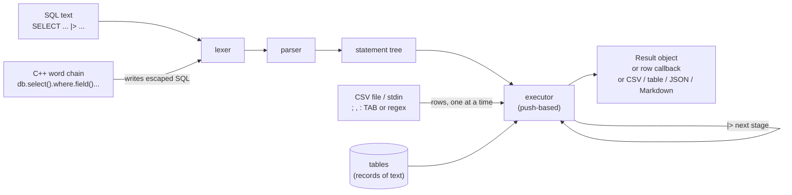
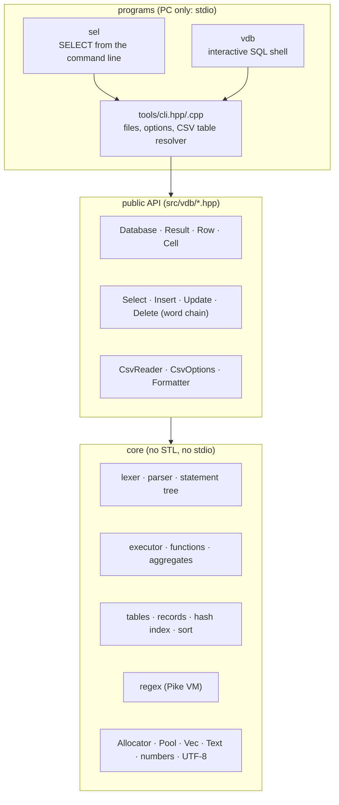
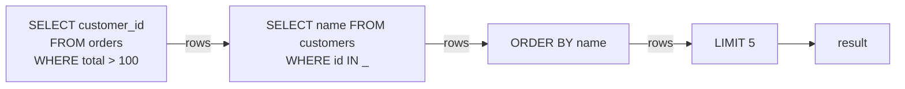
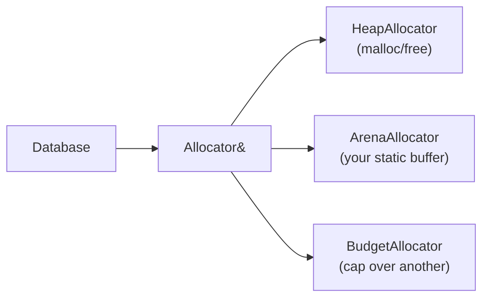

# vDB — Specification (SDD), v1.0

**What vDB is.** vDB is a small **in-memory database** written in C++11 with **no C++ standard library** (no STL, no
exceptions, no RTTI), so the same code runs on a PC and on a microcontroller. It stores **records**, not rows of a fixed
schema: each record is a set of named fields, and two records of the same table may have different fields (a missing
field reads as NULL). You ask it questions in **standard SQL text** (`SELECT name FROM people WHERE age > 30`) or with
a **C++ word chain** (`db.select("name").from("people").where.field("age").gt(30).run()`). The result of one query can
**flow into the next** with the pipe operator `|>`, so relations are built as a chain of small steps. Values are
**flexible**: everything is kept as text, and the operation decides how to read it — a math comparison reads numbers,
a text match reads text, in the same WHERE.

On top of the library sit two programs: **`sel`**, which makes a SELECT typed on the command line run over CSV files
(`sel name, age from people.csv where "age > 30"`), and **`vdb`**, an interactive SQL shell.

**Status (2026-10-29): v1.0 specified, built and tested** (§10 gives the numbers): 93 unit tests, the same 93 with the
microcontroller sizes, 31 program tests, the unit tests under AddressSanitizer and UndefinedBehaviorSanitizer, every
allocation of a test script failed in turn without a crash or a leak, 9 PC examples, the core compiled for the ESP32
(GCC 14) and the ATmega2560 (avr-gcc 7.3) with `-Werror`, both Arduino sketches compiled warning-free. Run on macOS
(clang 21); CI runs the same on Linux (GCC) and macOS. Not yet run on a board (§11 L3).

This file is normative: every change to behaviour, API, layout or tests is recorded here first (Spec-Driven
Development). Where this file and the code disagree, the disagreement is a defect to be resolved here first.

**Repository:** github.com/solariun/vDB (public), MIT license, Copyright (c) 2026 Gustavo Campos.

### Changelog

| Date | Change |
|---|---|
| 2026-10-29 | v1.0 specified with Gustavo's decisions D1–D5 (§0.2) and the design decisions A1–A20 (§0.3): flexible values, SQL with JOINs and pipelines, the word-chain API, the `sel` and `vdb` programs, the allocator model for MCUs. |
| 2026-10-29 | Gustavo, while it was being built: the CSV program is `sel`, written like a SELECT on the command line (D5; `select` is a reserved word of bash, zsh and sh, tested). |
| 2026-10-29 | v1.0 built: core library (13 files), `sel` and `vdb`, 9 PC examples, 2 Arduino sketches, 93 unit tests, 31 program tests, sanitizer, fault-injection, small-size and embedded runs, CI, README. Decisions A21–A32 taken while building (§0.3). Measured in §10.1. |
| 2026-10-29 | ORDER BY with LIMIT keeps only the top rows (L5): sorted and trimmed when the buffer doubles, stable; 1M rows with LIMIT 3: 113 MB → 195 KB, 1.27 → 0.41 s. Tests `streaming_order_by_limit_keeps_only_the_top_rows` and `order_by_limit_matches_a_full_sort_with_ties`. |
| 2026-10-29 | Found by the tests and fixed before release: the regex search stopped at the first position where a leading assertion (`\b`, `^` with `m`) failed; `POSITION(x IN y)`; 17-digit reals that did not read back exactly; `1e-300` overflowed the scaling; the group key buffer was 4 bytes on AVR for an 8-byte integer (found by avr-gcc); a full arena could not run `DELETE`; indexing a failed `Result` crashed; `FROM 'file.csv'` was refused; `vdb::Select q = db.select()...;` did not compile. |

### How to read this document

- Every section starts **in plain words**: what the thing is and why, often with a picture. **Exact rules** follow.
- "Must", "never" and "always" are normative. Named constants (`k_...`, `VDB_...`) are the ones in the code.
- §-references point inside this file; `file:line` references point into the repository.

---

## 0. Decisions

### 0.1 The idea in one picture



**In plain words.** Two ways in (SQL text and the C++ chain), one way to understand them (the parser), one engine that
runs them, and the engine's output can be fed back into itself with `|>`. Rows travel one at a time whenever possible,
so a filter over a large CSV file never holds the file in memory.

### 0.2 Gustavo's decisions (2026-10-29)

| # | Decision | In plain words: why |
|---|---|---|
| D1 | **The C++ API is a word chain:** `db.select("name, age").from("people").where.field("age").gt(30).and_().field("name").like("A%").order_by("age", vdb::DESC).limit(10).run()`. `where` is a member, not a call; AND binds before OR; `open()` / `close()` group. | Gustavo's own example, `select(sd).where.field(sdf)`, chosen over operator-overloaded expression objects. It reads left to right like the sentence it builds. |
| D2 | **Pipelines use `|>`**; each stage reads the previous stage's result; a stage may omit FROM and may be a bare clause (`|> WHERE ...`, `|> ORDER BY ...`, `|> LIMIT 5`); the previous result is also a table named `_` (for `IN _`, `JOIN _`). Shell pipes between programs work too. | The same shape as BigQuery/ZetaSQL pipe syntax, so it is not a private invention; `_` lets a later stage relate the previous result to another table ("emulating relations in a chain"). |
| D3 | **A math comparison against text that is not a number is UNKNOWN** (the row does not match, and `NOT` of it does not match either). `WHERE price > 10` skips `price = 'N/A'`; `price LIKE '%10%'` in the same WHERE still reads it as text. | "If the where is a math clause it will be treated as a number, but if I want to see if a sentence of numbers is there it will be treated as a string." UNKNOWN is SQL's own three-valued logic: a math clause matches only numbers, and never silently by text. |
| D4 | **JOINs are in** (INNER, LEFT, RIGHT, FULL, CROSS, comma), with a hash index for equality joins; **window functions are out** (listed as not supported, §3.12). | Standard SQL users expect JOIN; two large CSV files must join fast; window functions would roughly double the executor for little gain on a microcontroller. |
| D5 | **The CSV program is `sel`**, used like a SELECT typed in the shell: `sel name, age from people.csv where "age > 30" order by age`. Every setting is an `--option`. It is not called `select` because `select` is a reserved word of bash, zsh and sh (`select name, age from x.csv` is a parse error in all three, tested 2026-10-29); Gustavo chose a different name over a shell-init workaround. | "Make it like writing a select from command line." A name that needs no shell setup works in scripts, cron and every shell. |

### 0.3 Design decisions (proposed with the build, each with its reason and the alternative rejected)

| # | Decision | Why | Rejected |
|---|---|---|---|
| A1 | The word chain (D1) **writes SQL text** — every name quoted as an identifier, every value as a literal, with quotes doubled — and the one parser compiles it. `sql()` shows the text. | One grammar and one meaning; a chain can never mean something its SQL does not; users can print the SQL to learn it. Values are escaped, so user data can never become SQL (no injection). | Building the tree directly: two code paths to keep identical, twice the tests. |
| A2 | **Every stored value is text** (with a trailing NUL), or NULL. Numbers given through the API are formatted as text (integers exactly; reals with `k_real_digits` = 15 significant digits, 6 where `double` is 32-bit). | "String / text alike": `00123` keeps its zeros, a CSV round-trips byte for byte, and the operation decides how to read a value (D3). | Typed binary storage: loses the original text (leading zeros, `1.50`), and needs a schema. |
| A3 | **Three kinds of value in an expression:** a *number* (a bare literal like `30`, or the result of math), a *strict text* (a quoted literal `'30'`, or `CAST(x AS TEXT)`), and a *flexible text* (a field, or a function's text result), which is read as a number where the operation needs one and it parses. | Quoting is how the user says "compare as text": `zip = '01234'` compares text, `zip = 1234` compares numbers, in the same WHERE. | All text compared as numbers when possible: then there is no way to ask for a text comparison of digits. |
| A4 | **Empty CSV fields:** an unquoted empty field is NULL, a quoted empty field `""` is the empty text; the writer does the reverse, so files round-trip. `--empty-text` makes unquoted empties `''`. | PostgreSQL `COPY ... CSV` rule: both meanings stay expressible in the file. | Always empty text (NULL could not come from a file); always NULL (empty text could not). |
| A5 | **No C++ standard library:** no `std::`, no `<new>`, no `<initializer_list>`, no exceptions, no RTTI. C headers only (`<stddef.h>`, `<stdint.h>`, `<string.h>`, `<stdlib.h>`, `<math.h>`). Memory comes from a replaceable `vdb::Allocator`; `malloc` appears only in `HeapAllocator`. Running out of memory is an error code, never a crash. | MCU targets (AVR has no STL), predictable memory, the same code everywhere. | STL behind `#ifdef`s: two code bases. |
| A6 | **Regular expressions run on a Pike VM** (Thompson NFA with priorities and captures): time is O(text × pattern), never exponential. Pattern size is limited (`VDB_REGEX_MAX_PROGRAM`). | Safety: a pattern like `(a+)+$` cannot hang the program, on a PC or an MCU. | Backtracking with a step limit: still slow on the worst case and fails unpredictably. |
| A7 | **The executor is push-based:** a source pushes rows through JOIN, WHERE, grouping, projection, DISTINCT, ORDER BY and LIMIT into a sink; a stage of a pipeline is the sink of the stage before it; a satisfied LIMIT stops the source; ORDER BY with LIMIT keeps only the top rows (L5). A CSV table that is read once is **streamed** (never loaded) when it drives the first FROM item. | A filter over a 10 GB CSV uses kilobytes; `LIMIT 10` reads 10 rows; GROUP BY holds one record per group, ORDER BY only the projected rows. | Materialize everything: simple, but memory grows with the file. |
| A8 | **Names are case-insensitive** (ASCII), quoted or not. Duplicate output names get `_2`, `_3`, ... so a later stage can name every column. | CSV headers come in any case; SQL users expect `Name` = `name`. | Case-sensitive quoted names (standard): surprising with CSV headers. |
| A9 | **A SELECT without FROM reads `_`** when a table `_` is in scope (the previous pipeline stage, or the default input of `sel`/`vdb`); otherwise it produces one row (`SELECT 1 + 1`). | `sel "count(*)" < data.csv` and `|> SELECT name` read naturally. | Requiring FROM everywhere: noisy in pipelines. |
| A10 | **Table names in FROM/JOIN may be paths:** adjacent tokens with no space between them (`data/people.csv`, `../x.csv`, `~/a.csv`) form one name; `"my file.csv"` quotes one. An unknown name is offered to the database's **table resolver** (the programs load CSV files with it). The default alias of a path is its file name without extension (`people`). | `sel * from data/people.csv` must work; the library itself never opens files (MCUs have none). | A separate `--table` option for every file: noisy; it still exists (`-t name=file`). |
| A11 | `INSERT INTO t SELECT ...` **without a column list maps by name** (missing columns are created); with a column list, by position. `INSERT ... VALUES` without a list is positional over the table's columns. | Records are not rows of a fixed schema; matching by name never puts a value in the wrong field. | Positional always (standard): silently swaps fields when the orders differ. |
| A12 | `LIKE` is case-sensitive (standard), `ILIKE` is not; case folding covers ASCII and Latin-1 letters in UTF-8 (`Ç` ↔ `ç`, `Á` ↔ `á`). Text functions count UTF-8 characters, not bytes. | Portuguese and other Latin languages in real CSV files. | ASCII only: `UPPER('ação')` would give `AçãO`. |
| A13 | `REGEXP_REPLACE` replaces **every** match by default (flag `'1'`: only the first). | MySQL, Oracle, BigQuery, Snowflake behave so; most users expect it. | PostgreSQL's first-only default. |
| A14 | A scalar subquery that returns more than one row is an **error**; zero rows give NULL. | Standard SQL; silently taking the first row hides mistakes. | SQLite's first row. |
| A15 | A column used in an aggregate query without being grouped takes its value from the **first row of the group**. | Easy for every level (`SELECT city, name, COUNT(*) ... GROUP BY city` runs); documented. | An error (standard): blocks a common exploratory query. |
| A16 | Division or modulo by zero gives **NULL**; integer overflow turns the result into a real. | No undefined behaviour, no crash, a value that SQL already knows how to skip. | An error: one bad cell stops a whole CSV query. |
| A17 | On AVR, keyword tables, function tables and error texts live in **flash** (`VDB_FLASH`); elsewhere they are ordinary constants. | AVR copies string literals into its 8 KB of RAM. | Ignoring AVR: rules out the Mega. |
| A18 | **The default CSV delimiter is `;`** (Gustavo); `,` `:` TAB `|` space or any character by option, `auto` sniffs the header line, and `--regex-delimiter` takes any regular expression. | Gustavo's request; `;` is the common delimiter where the decimal comma is used. | — |
| A19 | `--decimal-comma` (or `Options::decimal_separator = ','`) reads `3,14` as a number and writes computed reals with a comma. | Brazilian and European CSV files. | — |
| A20 | Errors carry a position (`line:column`) for syntax and a **hint** for names: the closest existing table, column or function ("did you mean 'name'?"). `sel` adds shell hints (§7.3). | Safe and easy for every level: the message says what to do. | Bare error codes. |
| A21 | `INSERT` into a table that does not exist **creates it** (with the columns it names). | Records are free-form; `db.insert("log").value(...)` works on a fresh database. | An error: one more step for nothing. |
| A22 | FROM and JOIN accept a quoted text as a table name: `FROM 'people.csv'`. | The natural way to quote a file name. | Only `"..."`. |
| A23 | `UNION`, `INTERSECT` and `EXCEPT` combine **left to right**, with equal precedence. | SQLite does so; simple to explain. | INTERSECT first (standard): rarely matters, harder to read. |
| A24 | `IN (subquery)` and `IN table` compare like GROUP BY (§2.4): `'017'` is in a set that holds `17`. | One hash lookup per row. | The comparison of §2.3 per element: a scan per row. |
| A25 | Chain objects are **copyable**: `vdb::Select q = db.select("a").from("t");` keeps a deep copy. | People write exactly that; a reference to the temporary would dangle. | Move-only: does not compile in the common case. |
| A26 | Indexing a failed or shorter `Result` (`r[9]["x"]`) gives NULL cells, never a crash. | Safe for every level. | Undefined behaviour on misuse. |
| A27 | **Truth of text:** `true`, `yes`, `on`, `t`, `y` (any case) are true; a numeric text is its number; other text is false. `TRUE` and `FALSE` and comparison results compare by truth: `active = TRUE` matches `'yes'`. | CSV files spell booleans many ways. | Text always false (SQLite): `WHERE active` misses `true`. |
| A28 | `\w`, `\b` and `[:alpha:]` include the Latin letters (code points from U+00C0, × and ÷ excluded). | `\w+` must match `São`. | ASCII only. |
| A29 | `LOG(x)` is base 10 (PostgreSQL, SQLite); `LN(x)` natural; `LOG(b, x)` base b. `TRIM` without characters strips spaces, tabs, CR and LF. | The common meaning; CSV fields carry stray CRs and tabs. | MySQL's natural `LOG(x)`. |
| A30 | When memory is short, pools, vectors, texts and the CSV buffer fall back to the exact size they need; `DELETE` without WHERE allocates nothing. | A full arena can still be emptied (§10 test `safety_arena_database_survives_exhaustion`). | Fixed chunk sizes: a full database could not run `DELETE`. |
| A31 | `sel` streams only when its SQL is one statement; `vdb` never streams (tables stay loaded for the next statement). | A stream is read once (A7). | Streaming always: a second statement would see an empty table. |
| A32 | On AVR the nesting bound is 12 (`VDB_MAX_DEPTH`), 200 elsewhere. | Each level of an expression costs stack; the Mega has 8 KB of RAM in all. | One bound: either a stack overflow on AVR or a needless limit on a PC. |

---

## 1. Architecture

### 1.1 Layers



### 1.2 Repository layout

| Path | What |
|---|---|
| `src/vdb.h` | The include for Arduino and for everyone: `#include <vdb.h>`. |
| `src/vdb/` | The library (headers and sources; Arduino compiles every `.cpp` under `src/`). |
| `tools/` | `sel.cpp`, `vdb_shell.cpp`, and `cli.hpp/.cpp` shared by both (stdio, files). |
| `examples/pc/` | Numbered PC examples, from the first query to the MCU arena. |
| `examples/arduino/` | Sketches for the ESP32 and the ATmega2560. |
| `examples/data/` | The CSV files the examples, the README and the tests use. |
| `tests/` | The unit test harness and tests; `tests/tools/` the program tests. |
| `Makefile` | `make`, `make test`, `make test_tools`, `make sanitize`, `make check_embedded`, `make arduino_check`, `make examples`, `make install`. |

---

## 2. Data model and values

### 2.1 Database, tables, records

**In plain words.** A database holds named tables. A table holds records. A record is a list of fields; each field is
text or NULL. A table remembers the names of all fields any of its records ever had (its *columns*), in the order first
seen; a record that lacks a column reads NULL there.

```
table "people"     columns: name | age | city | email       (union of all records' fields)
  record 0                  Ana  | 31  | Rio  | NULL        (no email field)
  record 1                  Bo   | N/A | NULL | bo@x.org    (age is text that is not a number)
  record 2                  Cid  | 017 | Sao Paulo | NULL   (017 keeps its zero; reads as 17 in math)
```

Exact rules:

- A record is stored in one allocation: `varint(field count)`, then per field `varint(0)` for NULL or
  `varint(length + 1)`, the bytes and a NUL. Records with fewer fields than the table has columns read NULL in the rest.
- Table and column names are case-insensitive (A8) and unique within their scope. A table may be named `_` (A9).
- There are no indexes on tables, no constraints, no transactions. Joins, grouping, DISTINCT and `IN (subquery)`
  build temporary hash indexes per query.

### 2.2 Values in expressions

| Kind | Comes from | Example |
|---|---|---|
| NULL | `NULL`, a missing field, an unquoted empty CSV field, a failed math step | `NULL` |
| number (integer or real) | a bare numeric literal; `+ - * / %`; numeric functions; aggregates | `30`, `2.5`, `1e3` |
| strict text | a quoted literal; `CAST(x AS TEXT)` | `'30'`, `'Rio'` |
| flexible text | a field; a text function's result; a parameter given as text | the field `age` holding `017` |

A text **reads as a number** when, after optional ASCII spaces, it is: optional sign, digits with an optional decimal
separator and digits (at least one digit in all), optional exponent (`e`/`E`, optional sign, digits), then optional
spaces. The decimal separator is `.` or, with A19, `,`. Integers that fit int64 are integers; others are reals.
`inf`, `nan`, hex and thousands separators are not numbers.

### 2.3 Comparison rules (D3, A3)

For `= == <> != < <= > >=`, `BETWEEN`, `IN`, `IS DISTINCT FROM` and `CASE x WHEN`:

1. If either side is NULL the result is UNKNOWN (except `IS [NOT] DISTINCT FROM`, which treats two NULLs as equal).
2. If either side is a **number**, the other side must read as a number: numbers are compared; if it does not read as
   a number, the result is **UNKNOWN** (D3).
3. If both sides are **flexible** text and both read as numbers, numbers are compared.
4. Otherwise both are compared as text: byte by byte (UTF-8 code point order), case-sensitive.

| Expression | `age` = `'017'` | `age` = `'N/A'` |
|---|---|---|
| `age = 17` | true (numbers) | UNKNOWN (D3) |
| `age > 10` | true | UNKNOWN |
| `NOT (age > 10)` | false | UNKNOWN |
| `age = '017'` | true (text) | false |
| `age = '17'` | false (text: `017` ≠ `17`) | false |
| `age LIKE '%1%'` | true (text) | false |

The truth of a value (WHERE, AND, OR, NOT, CASE WHEN): NULL is UNKNOWN; a number is true when not 0; text follows A27.

Math (`+ - * / %`, unary `-`, numeric functions) reads each operand as a number; an operand that does not read gives
NULL. Integer math overflows into a real (A16). `/` of two integers is integer division when exact, real otherwise
(`7 / 2 = 3.5`, `6 / 2 = 3`). Division or modulo by zero gives NULL. `||` and text functions read numbers as their
formatted text.

### 2.4 Order and equality for ORDER BY, GROUP BY, DISTINCT, MIN/MAX and set operations

One total order: NULL < numbers < text. A flexible or strict text that reads as a number sorts and groups as that
number (`'10'`, `10.0`, ` 10` are one group; `'09'` sorts before `'10'`). Text sorts by bytes. NULLs are equal to each
other here (`GROUP BY` and `DISTINCT` keep one NULL group). `ORDER BY ... NULLS FIRST|LAST` overrides the place of
NULL (default: first for ASC, last for DESC). Sorting is stable.

### 2.5 Number output

Integers print exactly. Reals print with up to `k_real_digits` significant digits, without trailing zeros, in plain
notation from 1e-5 up to 10^`k_real_digits` and in exponent notation (`1.5e+20`) outside, with the decimal separator of
A19. The word chain writes reals with the shortest text that reads back as the same double (up to 17 digits). Booleans
are integers: true is 1, false is 0.

---

## 3. The SQL language

### 3.1 Lexical rules

- Keywords and names are case-insensitive. Names: letters, digits, `_` (not starting with a digit), or quoted with
  `"..."`, `` `...` `` or `[...]` (a doubled quote inside stands for one).
- Strings: `'...'` with `''` for a quote. Numbers: `12`, `1.5`, `.5`, `1e-3`.
- Parameters: `?` (next), `?N` (N-th, from 1).
- Comments: `-- to end of line`, `/* ... */`. Statements are separated by `;`.

### 3.2 Statements

```
script      := statement { ";" statement } [";"]
statement   := query | insert | update | delete | create | drop
query       := [ WITH name AS "(" query ")" { "," name AS "(" query ")" } ] compound { "|>" stage }
compound    := select_core { (UNION [ALL] | INTERSECT | EXCEPT) select_core } [order_by] [limit]
select_core := SELECT [DISTINCT | ALL] items [FROM from] [WHERE expr] [GROUP BY exprs] [HAVING expr]
stage       := [SELECT [DISTINCT] items] [FROM from] [WHERE expr] [GROUP BY exprs] [HAVING expr] [order_by] [limit]
               (at least one clause)
items       := item { "," item }          item := "*" | name ".*" | expr [[AS] alias]
from        := source { ("," source) | join }
source      := table_name [[AS] alias] | "(" query ")" [AS] alias
join        := [INNER | LEFT [OUTER] | RIGHT [OUTER] | FULL [OUTER] | CROSS] JOIN source [ON expr | USING "(" names ")"]
order_by    := ORDER BY expr [ASC | DESC] [NULLS (FIRST | LAST)] { "," ... }
limit       := LIMIT expr [OFFSET expr] | LIMIT expr "," expr | OFFSET expr [ROWS] | FETCH (FIRST|NEXT) expr ROWS ONLY
insert      := INSERT INTO name ["(" names ")"] (VALUES "(" exprs ")" { "," "(" exprs ")" } | query)
update      := UPDATE name SET name "=" expr { "," name "=" expr } [WHERE expr]
delete      := DELETE FROM name [WHERE expr]
create      := CREATE TABLE [IF NOT EXISTS] name ( "(" column_def { "," column_def } ")" | AS query )
column_def  := name [type_name ["(" number ["," number] ")"]]     (the type is accepted and ignored)
drop        := DROP TABLE [IF EXISTS] name
```

- `LIMIT a, b` is MySQL's form (skip a, take b). `USING (a, b)` means `ON l.a = r.a AND l.b = r.b`.
- ORDER BY may name a select alias, an output position (`ORDER BY 2`) or any expression over the sources.
- GROUP BY may name a select alias or position too. HAVING and ORDER BY may use aggregates.
- A table name in FROM/JOIN may be a path (A10). `_` is the previous stage's result (D2) or the default input (A9).
- DML results: `Result::changes()` counts the records inserted, updated or deleted; CREATE and DROP return no rows.

### 3.3 Operators, from lowest to highest precedence

| Level | Operators |
|---|---|
| 1 | `OR` |
| 2 | `AND` |
| 3 | `NOT` (prefix) |
| 4 | `= == != <> < <= > >=`, `IS [NOT] NULL`, `IS [NOT] TRUE/FALSE`, `IS [NOT] DISTINCT FROM`, `[NOT] BETWEEN a AND b`, `[NOT] IN (list / query / table)`, `[NOT] LIKE p [ESCAPE c]`, `[NOT] ILIKE`, `[NOT] GLOB`, `[NOT] REGEXP`, `[NOT] RLIKE`, `[NOT] SIMILAR TO`, `~ ~* !~ !~*` |
| 5 | `||` (concatenation) |
| 6 | `+ -` |
| 7 | `* / %` |
| 8 | unary `- +` |
| 9 | literals, parameters, names, `name.name`, calls, `( expr )`, `( query )`, `CASE`, `CAST`, `EXISTS ( query )` |

### 3.4 Text matching

| Form | Matches | Case |
|---|---|---|
| `x LIKE 'A%'` | `%` any run, `_` one character; `ESCAPE '\'` makes the next character literal | sensitive |
| `x ILIKE 'a%'` | as LIKE | insensitive (A12) |
| `x GLOB '*.csv'` | `*` any run, `?` one, `[a-z]` / `[^0-9]` classes | sensitive |
| `x SIMILAR TO '(A|B)%'` | the whole text, SQL:1999: `%` `_` plus regex `| * + ? {m,n} ( ) [ ]` | sensitive |
| `x REGEXP 'pat'`, `x RLIKE 'pat'`, `x ~ 'pat'` | a regex match anywhere (anchor with `^ $`) | sensitive |
| `x ~* 'pat'` | as `~` | insensitive |
| `x !~ 'pat'`, `x !~* 'pat'` | not | — |
| `CONTAINS(x, s)`, `STARTS_WITH(x, s)`, `ENDS_WITH(x, s)` | plain substring | sensitive |

### 3.5 Regular expressions (A6)

Syntax: literals; `.` (any character but newline; any with flag `s`); `[...]`, `[^...]` with ranges, escapes and the
POSIX classes `[:alpha:] [:digit:] [:alnum:] [:space:] [:upper:] [:lower:] [:punct:] [:xdigit:]`; `\d \D \w \W \s \S`;
`\b \B`; `^ $` (line ends too with flag `m`); groups `( )` and `(?: )`; `|`; `* + ? {n} {n,} {n,m}` and their lazy
forms with a trailing `?`; escapes `\t \n \r \f \v \xHH \uHHHH` and `\` before any punctuation. Matching is by UTF-8
code points, leftmost-first (Perl order). Flags (a text argument): `i` case-insensitive, `m` multi-line, `s` dot-all,
`1` first match only (REGEXP_REPLACE). `\w`, `\b` and `[:alpha:]` include Latin letters (A28). Not supported:
back-references, look-around, named groups. A pattern over `VDB_REGEX_MAX_PROGRAM` instructions or a repeat count over
1000 is an error.
In a replacement, `\N` or `$N` (N = 0..9) inserts group N, `\\` a backslash, `$$` a dollar.

### 3.6 Scalar functions

| Group | Functions |
|---|---|
| null and choice | `COALESCE(a, ...)`, `IFNULL(a, b)`, `NVL(a, b)`, `NULLIF(a, b)`, `IIF(c, a, b)`, `GREATEST(a, ...)`, `LEAST(a, ...)` |
| types | `TYPEOF(x)` → `null`/`integer`/`real`/`text`, `IS_NUMBER(x)` / `ISNUMERIC(x)` → 1/0, `CAST(x AS INTEGER/INT/BIGINT/REAL/FLOAT/DOUBLE/NUMERIC/DECIMAL/TEXT/VARCHAR/CHAR)` |
| text | `LENGTH`/`LEN`/`CHAR_LENGTH`, `OCTET_LENGTH`, `UPPER`/`UCASE`, `LOWER`/`LCASE`, `TRIM(x [, chars])`, `LTRIM`, `RTRIM`, `SUBSTR`/`SUBSTRING(x, start [, len])`, `LEFT(x, n)`, `RIGHT(x, n)`, `REPLACE(x, from, to)`, `INSTR(x, s)`, `POSITION(s IN x)`, `LPAD(x, n [, fill])`, `RPAD`, `REVERSE`, `REPEAT(x, n)`, `CONCAT(a, ...)` (skips NULL), `CONCAT_WS(sep, a, ...)`, `SPLIT_PART(x, sep, n)`, `INITCAP`, `ASCII`, `CHAR(n, ...)`, `CONTAINS`, `STARTS_WITH`, `ENDS_WITH`, `PRINTF`/`FORMAT(fmt, ...)` (`%s %d %i %f %.Nf %x %%`) |
| regex | `REGEXP_LIKE(x, p [, flags])`, `REGEXP_SUBSTR(x, p [, group [, flags]])` (alias `REGEXP_EXTRACT`), `REGEXP_REPLACE(x, p, r [, flags])`, `REGEXP_COUNT(x, p [, flags])`, `REGEXP_INSTR(x, p [, flags])` |
| math | `ABS`, `SIGN`, `ROUND(x [, d])`, `TRUNC`/`TRUNCATE(x [, d])`, `FLOOR`, `CEIL`/`CEILING`, `MOD(a, b)`, `POWER`/`POW`, `SQRT`, `EXP`, `LN`, `LOG(x)` / `LOG(b, x)`, `LOG10`, `LOG2`, `PI()`, `SIN`, `COS`, `TAN`, `ASIN`, `ACOS`, `ATAN`, `ATAN2`, `DEGREES`, `RADIANS` |

`REGEXP_SUBSTR` and `REGEXP_EXTRACT` return group 0 unless a group is given. `LOG(x)` is base 10 and `TRIM` strips
spaces, tabs, CR and LF unless characters are given (A29).
Positions are 1-based and count UTF-8 characters. A function given NULL returns NULL unless the table says otherwise
(the null-and-choice group, `CONCAT`, `CONCAT_WS`, `TYPEOF`, `IS_NUMBER`). A math function whose argument does not read
as a number returns NULL; a domain error (`SQRT(-1)`, `LN(0)`) returns NULL.

### 3.7 Aggregates

`COUNT(*)`, `COUNT(x)`, `COUNT(DISTINCT x)`, `SUM`, `TOTAL` (0 instead of NULL), `AVG`, `MIN`, `MAX`,
`GROUP_CONCAT(x [, sep])` / `STRING_AGG(x, sep)` (default separator `,`), `STDDEV`/`STDDEV_SAMP`, `STDDEV_POP`,
`VARIANCE`/`VAR_SAMP`, `VAR_POP`, `MEDIAN`. Every aggregate but `COUNT(*)` skips NULL; the numeric ones skip values
that do not read as numbers (D3). `DISTINCT` is accepted in every aggregate. An aggregate query without GROUP BY
returns exactly one row. MIN and MAX use the order of §2.4.

### 3.8 Joins (D4)

`a JOIN b ON c` (INNER), `LEFT`, `RIGHT`, `FULL`, `CROSS`, and the comma (cross join filtered by WHERE). The tree is
left-deep: `a JOIN b ... JOIN c ...` joins `(a ⋈ b) ⋈ c`. When ON holds an equality `l = r` (alone or under AND) whose
one side uses only the earlier sources and the other only the joined source, that source is indexed by a hash of `r`
once per query and each left row probes it; ON is still checked in full. Otherwise every pair is tested.

### 3.9 Subqueries and WITH

- `(SELECT ...)` as a value: zero rows → NULL; one row → its first column; more → error (A14).
- `x IN (SELECT ...)`, `x IN table_or__`: the first column, compared as GROUP BY does (A24), NULLs following SQL's rules.
- `EXISTS (SELECT ...)`.
- A subquery may name the columns of the query around it (*correlated*); it then runs once per outer row; otherwise
  it runs once per statement and its result is kept.
- `WITH a AS (...), b AS (...) query`: each named query is computed once, in order, and visible to the later ones and
  to every stage of the query.

### 3.10 Set operations

`UNION` (distinct), `UNION ALL`, `INTERSECT`, `EXCEPT` over the same number of columns; the names come from the first
SELECT; equality as in §2.4; left to right with equal precedence (A23). A trailing ORDER BY / LIMIT applies to the whole
compound and may name result columns or positions only.

### 3.11 Pipelines (D2)



```sql
SELECT customer_id FROM orders WHERE total > 100
|> SELECT name FROM customers WHERE id IN _
|> ORDER BY name
|> LIMIT 5
```

Exact rules:

- Stage 1 is a full query (WITH and set operations allowed). Each later stage is a stage of §3.2.
- Inside a stage, `_` is the previous stage's result; FROM omitted means `FROM _`; SELECT omitted means `SELECT *`.
- A stage whose only source is `_`, used once, receives the previous stage's rows as they are produced (A7);
  otherwise the previous result is first kept as a temporary table.
- A pipeline is a query: it can follow `CREATE TABLE x AS`, `INSERT INTO x`, appear in WITH and as a subquery.
- Between programs, CSV on stdin is `_`: `sel * from big.csv where "x > 1" | sel "count(*)"`.

### 3.12 Not supported in v1.0

Window functions (`OVER`), recursive WITH, `LATERAL`, date and time types and functions (ISO dates compare correctly
as text), indexes, constraints, transactions, views, triggers, `ALTER TABLE`, `NATURAL JOIN`, back-references in
regular expressions. Each gives a clear error (`not supported: ...`) when it is recognized.

---

## 4. The C++ API

### 4.1 Database and results

```cpp
#include <vdb.h>

vdb::Database db;                                    // heap allocator (PC)
db.exec("CREATE TABLE people (name, age, city)");
db.exec("INSERT INTO people VALUES ('Ana', 31, 'Rio'), ('Bo', 'N/A', NULL)");

vdb::Result r = db.query("SELECT name, age FROM people WHERE age > 30");
if (!r.ok()) printf("error: %s\n", r.error());
for (size_t i = 0; i < r.size(); ++i)
    printf("%s is %lld\n", r[i]["name"].text(), (long long)r[i]["age"].integer());
```

| Type | What it does |
|---|---|
| `Database(Allocator& = heap)` | Owns tables. Not copyable. One thread at a time. |
| `Result query(sql [, Params])` | Runs a script; returns the last statement's result (rows, or `changes()`), or the first error. |
| `Status exec(sql [, Params])` | Runs a script, discards rows. |
| `Status run(sql, RowSink&, [Params])` | Streams every SELECT's rows into `sink` (`begin`, `row`, `end` per statement); `row` returns false to stop. |
| `Result` | Owns its rows (movable, not copyable). `ok()`, `error()`, `size()`, `columns()`, `column_name(i)`, `column_index(name)`, `operator[](row)`, `changes()`, `write(Output&, Format)`. It may outlive the Database while the allocator lives. |
| `Row`, `Cell` | `row["name"]` or `row[i]`; `Cell::text()` (never null: `""` for NULL), `is_null()`, `is_number()`, `integer(default)`, `number(default)`, `size()`. |
| `Params` | `Params().add("Ana").add(31).add(2.5).add_null()` binds `?` / `?N` — the safe way to put user data in SQL text. |
| `Options` | `db.options().decimal_separator`, `.streaming` (A7), `.table_resolver` (A10). |
| Tables | `table(name)`, `table_count()`, `table_at(i)`, `drop_table(name)`, `Table::column_count/column_name/row_count`. |

### 4.2 The word chain (D1, A1)

```cpp
vdb::Result r = db.select("name, age")
    .from("people")
    .where.field("age").gt(30)
          .and_().field("name").like("A%")
    .order_by("age", vdb::DESC)
    .limit(10)
    .run();
```

| Part | Methods |
|---|---|
| start | `db.select(cols = "*")`, `db.insert(table)`, `db.update(table)`, `db.delete_from(table)` |
| `Select` | `distinct()`, `from(table [, alias])`, `join/left_join/right_join/full_join/cross_join(table [, alias])` then `.on` (a condition), `group_by(cols)`, `.having` (a condition), `order_by(col [, ASC/DESC])`, `limit(n)`, `offset(n)`, `then()` (a `|>` stage) followed by `select()`, `from()`, `.where`, ..., `sql()`, `run()`, `run(RowSink&)` |
| condition (`where`, `having`, `on`) | operands: `field(name)`, `expr(raw_sql)`; comparisons: `eq ne lt le gt ge`, `between(a, b)`, `in(a, b, ...)`, `not_in(...)`, `in_query(sql)`, `in_table(name)` (`in_table("_")`: the previous stage), `is_null()`, `is_not_null()`; text: `like`, `not_like`, `ilike`, `glob`, `regexp`, `not_regexp`, `similar_to`, `contains`, `starts_with`, `ends_with`; connectors: `and_()`, `or_()`, `not_()`, `open()`, `close()`; then any method of the statement it belongs to |
| values | `const char*` (text), integers, `double`, `bool`, `vdb::column("x")` (another field), `vdb::raw("x * 2")` (trusted SQL) |
| `Insert` | `value(name, v)` ... `row()` (next record) ... `run()` |
| `Update` | `set(name, v)` ..., `.where`, `run()` |
| `Delete` | `.where`, `run()` |

Chains are values: `vdb::Select q = db.select("a").from("t");` copies the chain (A25), so a query can be built step
by step (`if (adults) q.where.field("age").ge(18);`) and run later. `where` follows `on`: `.join("u").on.field(...)
.eq(...).where.field(...)`.

`field()`, `from()`, `set()` and `value()` quote names; values are written as literals with quotes doubled. Only
`expr()`, `raw()`, `select(cols)`, `group_by(cols)` and `order_by(col)` take SQL text as given — never pass user input
there; pass it as a value. A misuse of the chain (`gt()` without a field) makes `run()` return an error.

### 4.3 Memory (A5)



- `HeapAllocator` (default, `vdb::heap_allocator()`); `ArenaAllocator(buffer, size)` serves a static buffer (first fit,
  free blocks merged); `BudgetAllocator(parent, limit)` refuses beyond `limit` and reports `used()` and `peak()`.
- Every allocation failure becomes the error `out of memory` of the statement; the database stays consistent (a
  statement that fails halfway leaves earlier records and drops its own temporaries).
- Configuration macros (`src/vdb/config.hpp`): `VDB_NO_HEAP`, `VDB_POOL_CHUNK`, `VDB_SCRATCH_CHUNK`,
  `VDB_CSV_CHUNK`, `VDB_MAX_DEPTH` (parser and subquery nesting), `VDB_REGEX_MAX_PROGRAM`; smaller defaults on AVR.

### 4.4 CSV in the library

`CsvOptions` (delimiter char, or a regex; quote; header; trim; empty-as-text; strict; decimal separator), `CsvReader`
over a `ByteSource` (`read(buf, n)`), `db.load_csv(table, source, options)`, `db.attach_csv(table, source, options)`
(streamed when read once, A7), `db.load_csv_text(table, text, options)`, and `Formatter` writing a result or a stream
of rows as CSV, table, JSON, JSON lines or Markdown into an `Output` (`write(text, n)`). The library has no stdio:
the programs and sketches give the source and the output.

---

## 5. CSV format

**In plain words.** The first line names the fields; every next line is a record. Fields are split by the delimiter;
a field in double quotes may hold the delimiter, line breaks and doubled quotes.

Exact rules (reader):

- A UTF-8 byte-order mark at the start is skipped. Lines end with LF or CRLF.
- A field that starts with the quote character is quoted: it ends at the next single quote character; `""` inside is
  one quote; a quoted field may span lines. Text after the closing quote and before the delimiter is appended
  (`--strict`: an error).
- Unquoted fields end at the delimiter (a character, or the leftmost non-empty match of the regex delimiter).
- Header names are trimmed of spaces; an empty name becomes `cN` (N = position from 1); a repeated name gets `_2`,
  `_3`, ... With `--no-header` the names are `c1`, `c2`, ...
- A record with more fields than the header adds columns `cN`; one with fewer leaves NULLs. Both are counted;
  `--strict` makes them errors that name the line.
- Empty lines are skipped. Empty fields follow A4. `--trim` strips spaces around unquoted fields.

Exact rules (writer): fields holding the delimiter, the quote, CR or LF, or starting or ending with a space, are quoted;
NULL is written empty, the empty text as `""`; lines end with LF.

---

## 6. Output formats

| Format | Streams | Rules |
|---|---|---|
| `csv` | yes | §5 writer; header line unless disabled |
| `tsv` | yes | `csv` with TAB |
| `table` | no (widths) | box of `+ - |`, numbers right-aligned, widths in UTF-8 characters, `(N rows)` footer |
| `json` | yes | an array of objects; a value whose text is a JSON number is written as a number, NULL as `null`, everything else as a string with escapes |
| `jsonl` | yes | one object per line |
| `markdown` | yes | a GitHub table; `|` escaped |

---

## 7. Programs

### 7.1 `sel` — a SELECT typed on the command line (D5)

```
sel [options] <columns> [from <file|->] [join <file> on ...] [where ...] [group by ...] [having ...]
    [order by ...] [limit n] [|> stage ...]
```

**In plain words.** Type the SELECT you would write, after `sel` instead of `SELECT`. Every word that is not an
`--option` is part of the query; `sel` joins them with spaces and puts `SELECT` in front. The files in FROM and JOIN are
loaded as tables named after the file. Without FROM, the CSV comes from stdin.

```sh
sel name, age from people.csv where "age > 30" order by age desc
sel city, "count(*) as n" from people.csv group by city --output table
sel "*" from orders.csv join customers.csv on "orders.customer_id = customers.id" -o json
cat people.csv | sel name where "city like 'Rio%'"
sel -q "UPDATE people SET age = age + 1; SELECT * FROM people" -t people=people.csv
```

| Option | Meaning |
|---|---|
| `-d, --delimiter C` | input delimiter: one character, or `tab`, `comma`, `semicolon`, `colon`, `pipe`, `space`, `auto` (default `;`) |
| `-r, --regex-delimiter RE` | split fields with a regular expression |
| `-D, --output-delimiter C` | output delimiter (default: the input delimiter, or `;` after a regex) |
| `-o, --output FMT` | `csv` (default), `tsv`, `table`, `json`, `jsonl`, `markdown` |
| `-t, --table NAME=FILE` | load a file as table NAME (repeatable) |
| `-q, --query SQL` | run full SQL statements instead of the select words |
| `-f, --file FILE` | run the SQL in FILE |
| `-H, --no-header` | input files have no header line (columns `c1`, `c2`, ...) |
| `--no-output-header` | do not write the header line |
| `--quote C` | quote character (default `"`) |
| `--trim` | strip spaces around unquoted fields |
| `--empty-text` | unquoted empty fields are `''`, not NULL (A4) |
| `--decimal-comma` | numbers use `,` as the decimal separator (A19) |
| `--null TEXT` | how NULL is written in csv/table/markdown (default empty) |
| `--strict` | irregular rows and junk after quotes are errors |
| `--memory-limit SIZE` | stop with an error beyond SIZE bytes (`K`, `M`, `G` suffixes) |
| `--stats` | rows read, rows written, memory peak and time on stderr |
| `--show-sql` | print the SQL built from the words, then run it |
| `--help`, `--help-sql`, `--functions`, `--version` | help texts |
| `--` | everything after it is query text |

Exit codes: 0 success, 1 SQL or data error, 2 usage error, 3 file error.

Files: a name in FROM or JOIN is opened as a CSV file; `FROM people` also finds `people.csv`; `-`, `stdin` and a
missing FROM read stdin (when it is not a terminal; stdin can be read once). Files ending in `.tsv` or `.tab` use TAB
unless `-d` is given. A single-statement query streams its first file (A31). After the run, `sel` notes on stderr
the rows that had too few or too many fields, and a file whose only column's name holds `,`, TAB or `|` (a delimiter
hint).

### 7.2 Shell safety for `sel`

**In plain words.** The shell reads your line before `sel` does. Characters it treats specially must be quoted:

| You type | The shell does | Write instead |
|---|---|---|
| `where age > 30` | sends output to a file named `30` | `where "age > 30"` |
| `where name = 'Ana'` | removes the quotes: `name = Ana` | `where "name = 'Ana'"` |
| `sel * from x.csv` | replaces `*` with the files of the folder | `sel "*" from x.csv` |
| `count(*)` | syntax error (bash) / glob (zsh) | `"count(*)"` |
| `;` `|` `&` `<` | ends or redirects the command | quote them |

Quoting the whole query always works: `sel "name, age from people.csv where age > 30"`.

### 7.3 Hints `sel` gives (A20)

- On an unknown column after `|>`: a stage sees only the columns the stage before it selected.

- When the words before FROM are exactly the names of the files in the current folder, `sel` stops: "the shell
  replaced * with file names: write "*"" (exit 2).
- When WHERE or HAVING is a bare name (`where age`), `sel` warns on stderr that a `>` or `<` may have become a
  redirection.
- When a name is not a column and looks like a value, the error adds: "if Ana is a text value, quote it so the shell
  keeps the quotes: "name = 'Ana'"".

### 7.4 `vdb` — the interactive shell

```
vdb [options] [script.sql ...]
vdb -c "SQL"                      run and exit
```

Statements end with `;`. Dot commands: `.help`, `.tables`, `.schema [table]`, `.load FILE [NAME]`, `.save TABLE FILE`,
`.mode csv|tsv|table|json|jsonl|markdown`, `.delimiter C`, `.headers on|off`, `.nullvalue TEXT`, `.timer on|off`,
`.read FILE`, `.quit`. FROM may name CSV files as in `sel`. Options: the CSV options of `sel`, `-o FMT`,
`-t NAME=FILE`, `-c SQL`. With a terminal the default mode is `table`, otherwise `csv`.

---

## 8. Microcontrollers

- The core compiles with `-fno-exceptions -fno-rtti -nostdinc++` and references no C++ runtime symbol (no
  `operator new/delete`, no `__cxa_*` beyond what a virtual call needs, no typeinfo): `make check_embedded`.
- Targets proven by compilation (`make arduino_check`): ESP32 (`esp32:esp32:esp32`) and ATmega2560
  (`arduino:avr:mega`). The ATmega328P (Uno/Nano: 32 KB flash, 2 KB RAM) is too small for the SQL engine: the Mega
  sketch alone takes 137 KB of flash (§10.1).
- `make test_small` runs every unit test with the microcontroller sizes (`VDB_POOL_CHUNK` 256, `VDB_SCRATCH_CHUNK`
  128, `VDB_CSV_CHUNK` 64, `VDB_MAX_DEPTH` 12): the small configuration is proven correct on the PC, not only compiled.
- An MCU sketch gives the database an `ArenaAllocator` over a static buffer; nothing else allocates.
- `double` is 32-bit on AVR: reals have about 7 digits there (`k_real_digits` = 6).

---

## 9. Errors and safety

- No function of the library throws, aborts or prints. Every failure is a `Status` / `Result` with a message:
  syntax errors with `line:column` and the token, name errors with a hint (A20), runtime errors (`out of memory`,
  `scalar subquery returned more than one row`, `regex: ...`, `csv line N: ...`).
- Nesting is bounded (`VDB_MAX_DEPTH`): deep parentheses or subqueries are an error, never a stack overflow.
- Regular expressions are linear-time (A6). LIKE and GLOB are matched without exponential backtracking.
- A script is parsed completely before its first statement runs: a syntax error changes nothing.
- User values go into SQL through `Params` or the word chain (A1), never by pasting text.

---

## 10. Proof

| Gate | Command | Result (2026-10-29) |
|---|---|---|
| unit tests | `make test` | 93 of 93 |
| unit tests, microcontroller sizes | `make test_small` | 93 of 93 |
| program tests | `make test_tools` | 31 of 31 golden outputs of `sel` and `vdb` (options, formats, joins of files, stdin, shell pipes, hints, exit codes, memory limits) |
| sanitizers | `make sanitize` | 93 of 93 under ASan + UBSan, no report |
| fault injection | `make test` (`safety_every_allocation_failure_is_an_error_and_leaks_nothing`) | each allocation of a 9-statement script (joins, groups, pipelines, regex, subqueries, DML) failed in turn: every run an `out of memory` error, 0 blocks leaked |
| random input | `make test` | 3,000 random SQL token soups and 2,000 random CSV byte strings: no crash |
| examples | `make examples_run` | 9 of 9 |
| embedded | `make check_embedded` | no C++ runtime, exception, RTTI or heap symbol with `-nostdinc++ -fno-exceptions -fno-rtti -DVDB_NO_HEAP`; avr-gcc 7.3 (ATmega2560) and GCC 14.2 (ESP32) compile the core with `-Wall -Wextra -Wpedantic -Werror` |
| Arduino | `make arduino_check` | both sketches compile warning-free |

### 10.1 Measured (2026-10-29, Apple M-series, macOS, clang 21, `-O2`)

`sel` over generated files: `big.csv` (1,000,000 rows, 20.7 MB, `id;city;amount`) and `names.csv` (100,000 rows):

| Query | Time | Memory peak |
|---|---|---|
| `count(*) where amount > 500` (streamed) | 0.087 s | 83 KB |
| `city, count(*), avg(amount) group by city` (streamed, 100 groups) | 0.108 s | 141 KB |
| `where city regexp '^city(1\|2)[0-9]$'` (streamed) | 0.142 s | 83 KB |
| `big join names on n.id = b.id` (big streamed, names hashed) | 0.113 s | 12.1 MB |
| 3-stage pipeline (group, filter, count) | 0.106 s | 129 KB |
| `order by amount desc, id limit 3` (top-N: about 2 × 3 rows held) | 0.413 s | 195 KB |
| `order by amount desc, id` (full sort: all 1,000,000 rows held) | 1.448 s | 113 MB |
| `count(*)` of 2,000,000 rows from stdin under `--memory-limit 1M` | 0.111 s | 83 KB |

Sizes: `libvdb.a` 299 KB (arm64, `-O2`); ESP32 sketch 392,363 B of flash and 71,404 B of static RAM (with its 48 KB
arena); ATmega2560 sketch 137,248 B of flash and 4,984 B of static RAM (with its 4 KB arena). Structures on AVR against
a 64-bit PC (bytes): Value 14 / 32, Expr 66 / 152, SelectItem 17 / 48, FromItem 17 / 64, Table 23 / 96. The Mega
sketch's statements run on the PC with the AVR chunk sizes in an 8 KB arena (peak 7,888 B with 8-byte pointers);
scaled by the structure sizes, about 3–3.5 KB on AVR (*estimate*: L3).

---

## 11. Limits and open problems

| # | Limit |
|---|---|
| L1 | Nested-loop joins without an equality are O(n × m). |
| L2 | Correlated subqueries run once per outer row. |
| L3 | No sketch has run on a board yet; the MCU proof is compilation, `make test_small`, and the PC run of the Mega sketch's statements with the AVR sizes. The Mega's 4 KB arena is an estimate from structure sizes. |
| L4 | `table` output buffers the whole result to measure widths. |
| L5 | A full ORDER BY (no LIMIT) holds every projected row plus 32 bytes (16 on AVR) per sort key per row (113 MB for 1M rows, §10.1). With LIMIT n the buffer is sorted and trimmed to n + OFFSET rows whenever it doubles (at least 1,024 rows): 195 KB for the same file. |
| L6 | A stream (stdin, or a file `sel` streams) is read once: a second statement of the same script cannot read it again (A31). |
| L7 | `\w` and case folding cover Latin scripts; other scripts match `.`, classes and literals but not `\w` or ILIKE folding. |

---

## 12. Glossary

| Term | Meaning |
|---|---|
| record | one entry of a table: named fields, each text or NULL |
| column | a field name some record of the table has had |
| flexible text | a value from data, read as a number where an operation needs one (§2.2) |
| strict text | a quoted literal: always compared as text (§2.2) |
| UNKNOWN | SQL's third truth value; a row whose WHERE is UNKNOWN is not returned |
| stage | one step of a pipeline, after `|>` |
| `_` | the previous stage's result, or the default input of a program |
| driving source | the first FROM item; it may be streamed (A7) |
| Pike VM | a regex machine that runs all alternatives in step, in linear time |
